# Casos de Prueba — MarkdownCheck

**Analizador léxico-sintáctico de Markdown a HTML**
Lenguajes Formales y de Programación · Proyecto 2 · USAC

| | |
|---|---|
| **Autor** | `Oliver Jorge Raxtún Morales` |
| **Carnet** | `202400634` |
| **Fecha de ejecución** | `22/10/2026` |

---

## Guía de capturas pendientes

El texto y los resultados de este documento ya están completos (se obtuvieron ejecutando los casos con el código del proyecto). Falta insertar **20 capturas de pantalla**: cada espacio `📸` indica **qué capturar** y el **nombre de archivo sugerido** dentro de `docs/img/`.

**Procedimiento general para las capturas de cada caso (P-CP-xx):**

1. Ejecutar `python src/main.py`.
2. Pegar en el editor la **entrada** del caso (o cargar el archivo correspondiente).
3. Pulsar **▶ Analizar**.
4. Capturar la ventana completa mostrando la pestaña indicada (**Errores** si el caso tiene errores, **Tokens** si es válido).

| ID | Qué capturar |
|---|---|
| P-01 | Terminal con la suite completa de pruebas (`Ran 156 tests … OK`) |
| P-02 | Terminal con la tabla `python tests/test_casos_prueba.py --tabla` (`18/18 casos aprobados`) |
| P-CP-01 … P-CP-18 | Una captura de la GUI por cada caso (ver cada caso) |

---

## 1. Introducción

### 1.1 Objetivo

Verificar que MarkdownCheck cumple los requisitos del enunciado: reconocimiento correcto de los elementos del subconjunto de Markdown, detección y reporte preciso de errores léxicos y sintácticos con recuperación (modo pánico), generación de los tres reportes HTML y del árbol DOT, y cumplimiento de las restricciones de implementación.

### 1.2 Estrategia

Se aplican dos niveles de prueba:

| Nivel | Descripción | Dónde |
|---|---|---|
| **Casos de prueba funcionales** | 18 casos (entrada → resultado esperado → resultado obtenido) ejecutados sobre el sistema completo | Este documento + `tests/test_casos_prueba.py` |
| **Pruebas automatizadas** | 156 pruebas `unittest` (léxico, sintáctico, errores, reportes, restricciones, GUI) | `tests/` |

### 1.3 Entorno

| Elemento | Valor |
|---|---|
| Sistema operativo | `SISTEMA OPERATIVO Y VERSIÓN` |
| Python | `V 3.12` |
| Interfaz | Tkinter |
| Graphviz | `Instalado` |

### 1.4 Cómo ejecutar las pruebas

```bash
# Suite completa (desde la raíz del proyecto)
python -m unittest discover -s tests -v

# Tabla entrada / esperado / obtenido de los 18 casos
python tests/test_casos_prueba.py --tabla
```

Las pruebas de la interfaz gráfica se omiten automáticamente si el equipo no tiene pantalla o Tkinter (en ese caso se informa `skipped=4`).

---

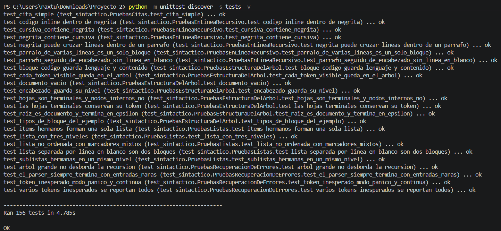

---

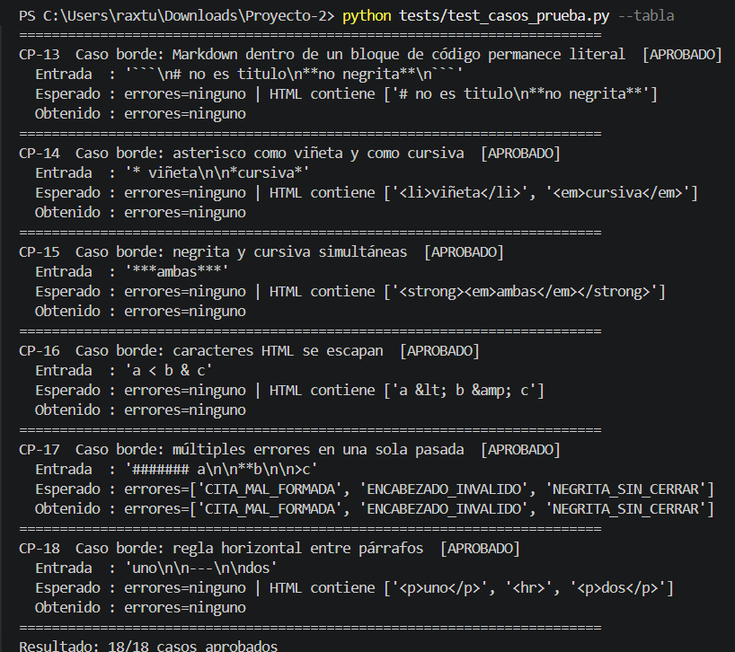

---

## 2. Resumen de resultados

| ID | Caso | Tipo | Resultado |
|---|---|---|---|
| CP-01 | Documento válido con todos los elementos obligatorios | Válido | ✓ Aprobado |
| CP-02 | Listas con 3 niveles de anidamiento | Válido | ✓ Aprobado |
| CP-03 | Citas anidadas (`>>` y `> >`) | Válido | ✓ Aprobado |
| CP-04 | Negrita sin cerrar | Error léxico | ✓ Aprobado |
| CP-05 | Cursiva sin cerrar | Error léxico | ✓ Aprobado |
| CP-06 | Código en línea sin cerrar | Error léxico | ✓ Aprobado |
| CP-07 | Encabezado inválido (7 numerales) | Error léxico | ✓ Aprobado |
| CP-08 | Bloque de código sin cerrar | Error léxico | ✓ Aprobado |
| CP-09 | Indentación inconsistente (salto de 0 a 4 espacios) | Error sintáctico | ✓ Aprobado |
| CP-10 | Cita mal formada (sin espacio tras `>`) | Error sintáctico | ✓ Aprobado |
| CP-11 | Borde: documento vacío | Borde | ✓ Aprobado |
| CP-12 | Borde: `#sinespacio` es texto | Borde | ✓ Aprobado |
| CP-13 | Borde: Markdown dentro de un bloque de código | Borde | ✓ Aprobado |
| CP-14 | Borde: asterisco como viñeta y como cursiva | Borde | ✓ Aprobado |
| CP-15 | Borde: negrita y cursiva simultáneas | Borde | ✓ Aprobado |
| CP-16 | Borde: caracteres HTML se escapan | Borde | ✓ Aprobado |
| CP-17 | Borde: múltiples errores en una sola pasada | Borde | ✓ Aprobado |
| CP-18 | Borde: regla horizontal entre párrafos | Borde | ✓ Aprobado |

**Casos aprobados: 18 / 18 (100 %).**

**Objetivo SMART (Medible):** el enunciado exige reconocer correctamente al menos el **90 %** de los elementos Markdown de los casos de prueba. Sobre el documento de CP-01 se verificaron 19 elementos (encabezados, párrafo, negrita, cursiva, código en línea, lista y sus 8 ítems, citas, bloque de código, regla horizontal y texto final) y **los 19 fueron reconocidos (100 %)**; el criterio se verifica automáticamente en `test_reconocimiento_de_al_menos_90_por_ciento_de_los_elementos`.

> **Nota sobre los tokens:** el número de tokens indicado en cada caso corresponde a la tabla de tokens de la aplicación; incluye los tokens técnicos `NUEVA_LINEA`, `SALTO_LINEA` y `FIN`, y excluye los cierres sintéticos de recuperación.

---

## 3. Casos de prueba funcionales

### 3.1 Casos con documentos válidos

#### CP-01 — Documento válido con todos los elementos obligatorios

| | |
|---|---|
| **Objetivo** | Verificar que el documento de ejemplo del enunciado (§4.7) se reconozca sin errores y se generen los 3 reportes y el árbol |
| **Archivo** | `examples/ejemplo_valido.md` |

**Entrada:**

````markdown
# Proyecto de Lenguajes Formales

Este curso combina **teoría sólida** y *práctica de código*, con ejemplos en `Python`.
## Contenido del curso

- Análisis léxico
   - Autómatas finitos
   - Expresiones regulares
- Análisis sintáctico
   - Gramáticas libres de contexto
     - Recursión por la izquierda
     - Recursión por la derecha
- Generación de código

> El análisis sintáctico es donde la teoría se encuentra con la práctica.
>> Y donde más se aprende, según los estudiantes.

```python
def hola():
    print("Hola LFP")
```

---

Fin del documento.
````

**Resultado esperado:**

- 0 errores léxicos y 0 sintácticos.
- Se generan `reporte1_documento.html`, `reporte2_estadisticas.html`, `reporte3_indice.html` y `arbol.dot`.
- Reporte 1 con `<h1>`, `<h2>`, `<strong>`, `<em>`, `<code>`, `<ul>` anidados (3 niveles), `<blockquote>` anidados (2 niveles), `<pre><code class="language-python">` y `<hr>`.
- Reporte 2: 67 palabras, 2 párrafos, 2 encabezados (H1 = 1, H2 = 1), 8 ítems, 2 líneas de cita, 1 bloque de código, profundidad de listas = 3 niveles, de citas = 2 niveles, 1 negrita, 1 cursiva, 1 código en línea, 1 regla horizontal.
- Reporte 3: 2 entradas (H1 y H2 sangrado) con enlaces al Reporte 1.

**Resultado obtenido:**

- 70 tokens, **0 errores**. Los 3 reportes y `arbol.dot` se generaron correctamente.
- Reporte 2: palabras = 67 · párrafos = 2 · encabezados = 2 (H1 = 1, H2 = 1) · listas = 1 · ítems = 8 · citas = 1 · líneas de cita = 2 · bloques de código = 1 · profundidad listas = 3 · profundidad citas = 2 · negritas = 1 · cursivas = 1 · código en línea = 1 · reglas = 1.
- Fragmento del Reporte 1 (cuerpo):

```html
<h1 id="seccion-1">Proyecto de Lenguajes Formales</h1>
<p>Este curso combina <strong>teoría sólida</strong> y <em>práctica de código</em>, con ejemplos en <code>Python</code>.</p>
<h2 id="seccion-2">Contenido del curso</h2>
<ul>
<li>Análisis léxico
<ul>
<li>Autómatas finitos</li>
<li>Expresiones regulares</li>
</ul></li>
<li>Análisis sintáctico
<ul>
<li>Gramáticas libres de contexto
<ul>
<li>Recursión por la izquierda</li>
<li>Recursión por la derecha</li>
</ul></li>
</ul></li>
<li>Generación de código</li>
</ul>
<blockquote>
<p>El análisis sintáctico es donde la teoría se encuentra con la práctica.</p>
<blockquote>
<p>Y donde más se aprende, según los estudiantes.</p>
</blockquote>
</blockquote>
<pre><code class="language-python">def hola():
    print(&quot;Hola LFP&quot;)</code></pre>
<hr>
<p>Fin del documento.</p>
```

**Estado:** ✓ Aprobado


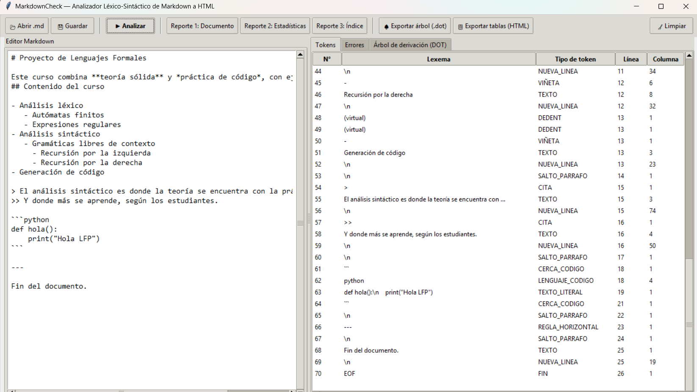

---

#### CP-02 — Listas con 3 niveles de anidamiento (y más)

| | |
|---|---|
| **Objetivo** | Verificar que las sublistas por indentación (2 espacios = 1 nivel) se traduzcan a `<ul><li>` con la jerarquía exacta |

**Entrada:**

~~~markdown
- uno
  - dos
    - tres
      - cuatro
~~~

**Resultado esperado:** 0 errores; 4 niveles de `<ul>` anidados dentro de los `<li>` correspondientes; tokens `INDENT` ×3 y `DEDENT` ×3 balanceados.

**Resultado obtenido:** 19 tokens, **0 errores**.

```html
<ul>
<li>uno
<ul>
<li>dos
<ul>
<li>tres
<ul>
<li>cuatro</li>
</ul></li>
</ul></li>
</ul></li>
</ul>
```

**Estado:** ✓ Aprobado

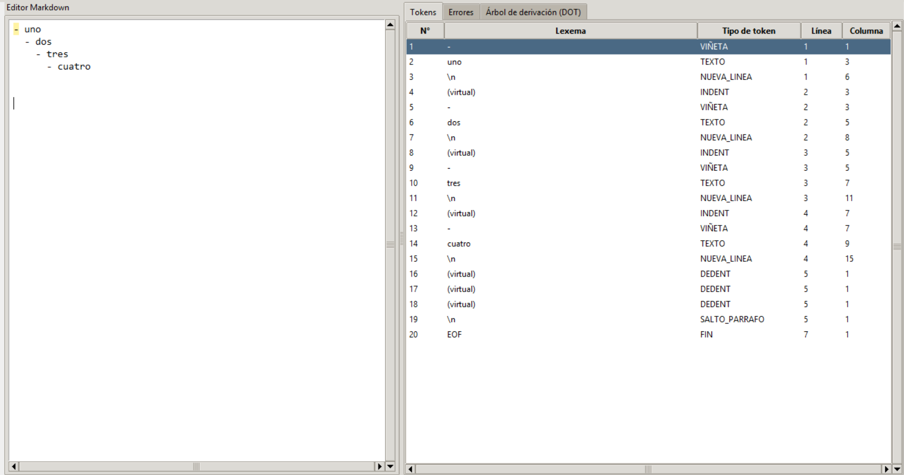

---

#### CP-03 — Citas anidadas (`>>` y `> >` equivalentes)

| | |
|---|---|
| **Objetivo** | Verificar que ambas notaciones de anidamiento se acepten y generen `<blockquote>` anidados a la misma profundidad |

**Entrada:**

~~~markdown
> nivel 1
>> nivel 2
> > nivel 2 bis
~~~

**Resultado esperado:** 0 errores; `<blockquote>` de nivel 1 con un `<blockquote>` interior que contiene las dos líneas de nivel 2.

**Resultado obtenido:** 10 tokens, **0 errores**.

```html
<blockquote>
<p>nivel 1</p>
<blockquote>
<p>nivel 2</p>
<p>nivel 2 bis</p>
</blockquote>
</blockquote>
```

**Estado:** ✓ Aprobado

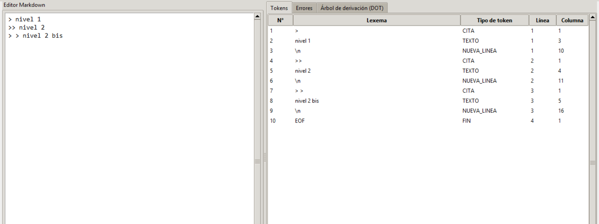

---

### 3.2 Casos con errores léxicos

#### CP-04 — Negrita sin cerrar

**Entrada:**

~~~markdown
Texto con **negrita abierta
~~~

**Resultado esperado:** 1 error `NEGRITA_SIN_CERRAR` (Léxico) en la posición del `**` de apertura (línea 1, columna 11). No se generan reportes.

**Resultado obtenido:** 5 tokens, 1 error:

| Tipo | Fase | Línea | Columna | Descripción |
|---|---|---|---|---|
| `NEGRITA_SIN_CERRAR` | Léxico | 1 | 11 | Negrita sin cerrar iniciada en línea 1, columna 11 |

**Estado:** ✓ Aprobado

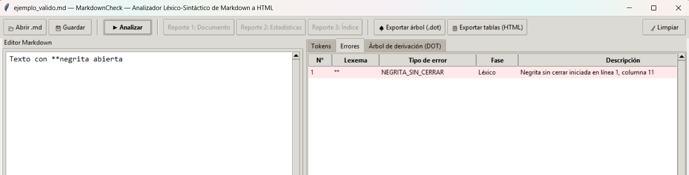

---

#### CP-05 — Cursiva sin cerrar

**Entrada:**

~~~markdown
Texto con *cursiva abierta
~~~

**Resultado esperado:** 1 error `CURSIVA_SIN_CERRAR` (Léxico) en línea 1, columna 11.

**Resultado obtenido:** 5 tokens, 1 error:

| Tipo | Fase | Línea | Columna | Descripción |
|---|---|---|---|---|
| `CURSIVA_SIN_CERRAR` | Léxico | 1 | 11 | Cursiva sin cerrar iniciada en línea 1, columna 11 |

**Estado:** ✓ Aprobado

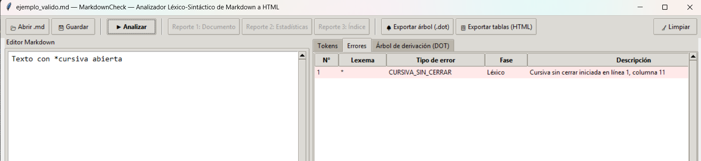

---

#### CP-06 — Código en línea sin cerrar

**Entrada:**

~~~markdown
Texto con `codigo abierto
~~~

**Resultado esperado:** 1 error `CODIGO_INLINE_SIN_CERRAR` (Léxico) en línea 1, columna 11.

**Resultado obtenido:** 5 tokens, 1 error:

| Tipo | Fase | Línea | Columna | Descripción |
|---|---|---|---|---|
| `CODIGO_INLINE_SIN_CERRAR` | Léxico | 1 | 11 | Código en línea sin cerrar iniciado en línea 1, columna 11 |

**Estado:** ✓ Aprobado

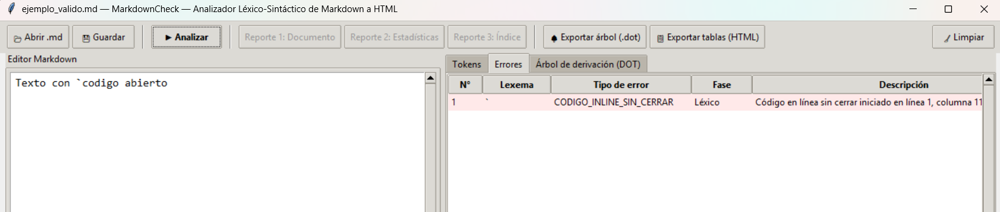

---

#### CP-07 — Encabezado inválido (7 numerales)

**Entrada:**

~~~markdown
####### Demasiado profundo
~~~

**Resultado esperado:** 1 error `ENCABEZADO_INVALIDO` (Léxico) en línea 1, columna 1, con el mensaje «máximo 6 niveles». La línea se trata como texto y el análisis continúa.

**Resultado obtenido:** 3 tokens, 1 error:

| Tipo | Fase | Línea | Columna | Descripción |
|---|---|---|---|---|
| `ENCABEZADO_INVALIDO` | Léxico | 1 | 1 | Encabezado inválido en línea 1: máximo 6 niveles |

**Estado:** ✓ Aprobado

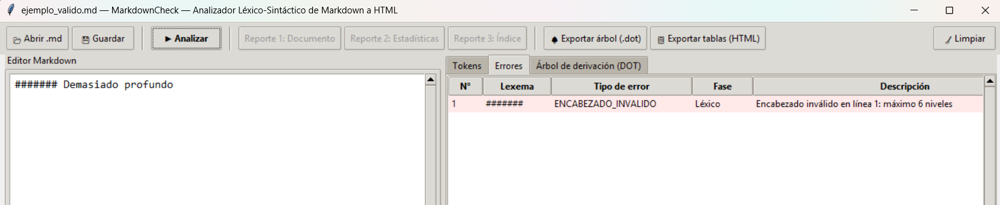

---

#### CP-08 — Bloque de código sin cerrar

**Entrada:**

~~~markdown
```python
print('hola')
~~~

*(La entrada son las dos líneas anteriores: la cerca de apertura con el lenguaje y una línea de código, sin cerca de cierre.)*

**Resultado esperado:** 1 error `BLOQUE_CODIGO_SIN_CERRAR` (Léxico) en línea 1 (línea de la cerca de apertura).

**Resultado obtenido:** 4 tokens, 1 error:

| Tipo | Fase | Línea | Columna | Descripción |
|---|---|---|---|---|
| `BLOQUE_CODIGO_SIN_CERRAR` | Léxico | 1 | 1 | Bloque de código sin cerrar iniciado en línea 1 |

**Estado:** ✓ Aprobado

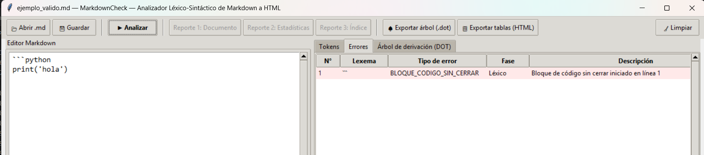

---

### 3.3 Casos con errores sintácticos

#### CP-09 — Indentación inconsistente (salto de 0 a 4 espacios)

**Entrada:**

~~~markdown
- raíz
    - salto inválido
~~~

**Resultado esperado:** 1 error `INDENTACION_INVALIDA` (Sintáctico) en línea 2, columna 5 (el ítem sube dos niveles de una vez).

**Resultado obtenido:** 9 tokens, 1 error:

| Tipo | Fase | Línea | Columna | Descripción |
|---|---|---|---|---|
| `INDENTACION_INVALIDA` | Sintáctico | 2 | 5 | Indentación inválida en línea 2, columna 5 |

**Estado:** ✓ Aprobado

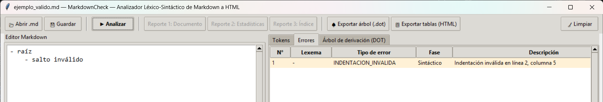

---

#### CP-10 — Cita mal formada (sin espacio tras `>`)

**Entrada:**

~~~markdown
>sin espacio
~~~

**Resultado esperado:** 1 error `CITA_MAL_FORMADA` (Sintáctico) en línea 1, columna 1.

**Resultado obtenido:** 4 tokens, 1 error:

| Tipo | Fase | Línea | Columna | Descripción |
|---|---|---|---|---|
| `CITA_MAL_FORMADA` | Sintáctico | 1 | 1 | Cita mal formada en línea 1, columna 1 |

**Estado:** ✓ Aprobado

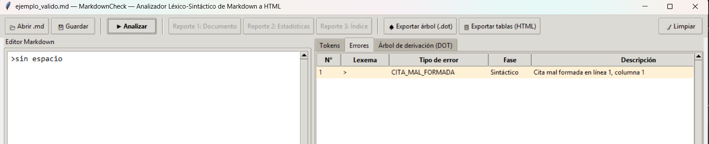

---

### 3.4 Casos borde

#### CP-11 — Documento vacío

**Entrada:** *(vacía; editor sin texto)*

**Resultado esperado:** 0 errores; sin bloques; el árbol es `<documento> ⇒ ε`. Se generan los reportes (Reporte 3 indica que no hay encabezados).

**Resultado obtenido:** 1 token (`FIN`), **0 errores**. Cuerpo HTML vacío; el Reporte 3 muestra «Este documento no contiene encabezados…».

**Estado:** ✓ Aprobado

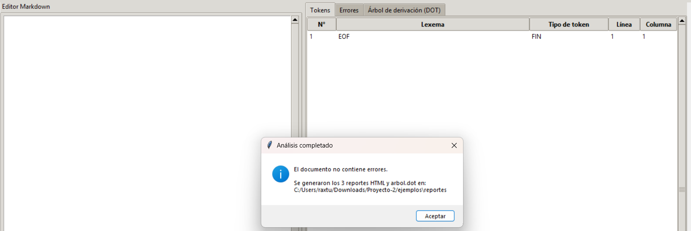

---

#### CP-12 — `#sinespacio` es texto, no encabezado

**Entrada:**

~~~markdown
#sinespacio
~~~

**Resultado esperado:** 0 errores; se reconoce como `TEXTO` y se traduce a un párrafo.

**Resultado obtenido:** 3 tokens, **0 errores**.

```html
<p>#sinespacio</p>
```

**Estado:** ✓ Aprobado

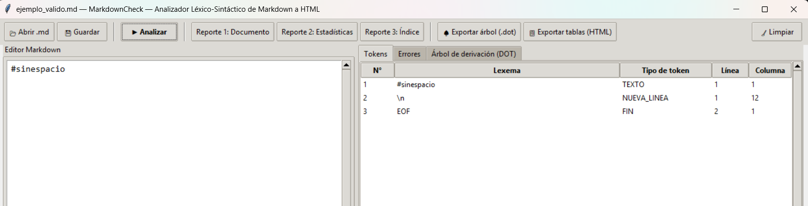

---

#### CP-13 — Markdown dentro de un bloque de código permanece literal

**Entrada:**

~~~markdown
```
# no es titulo
**no negrita**
```
~~~

**Resultado esperado:** 0 errores; el contenido se entrega como un único `TEXTO_LITERAL`, sin tokenizar `#` ni `**`.

**Resultado obtenido:** 4 tokens (`CERCA_CODIGO`, `TEXTO_LITERAL`, `CERCA_CODIGO`, `FIN`), **0 errores**.

```html
<pre><code># no es titulo
**no negrita**</code></pre>
```

**Estado:** ✓ Aprobado

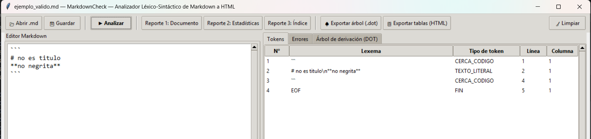

---

#### CP-14 — Asterisco como viñeta y como cursiva

**Entrada:**

~~~markdown
* viñeta

*cursiva*
~~~

**Resultado esperado:** 0 errores; el primer `*` (seguido de espacio, al inicio de línea) es `VIÑETA`; el segundo (sin espacio) es `CURSIVA`.

**Resultado obtenido:** 9 tokens, **0 errores**.

```html
<ul>
<li>viñeta</li>
</ul>
<p><em>cursiva</em></p>
```

**Estado:** ✓ Aprobado

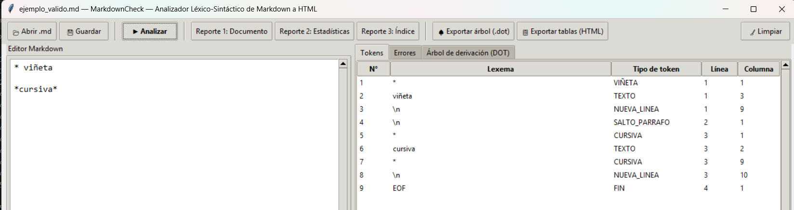

---

#### CP-15 — Negrita y cursiva simultáneas

**Entrada:**

~~~markdown
***ambas***
~~~

**Resultado esperado:** 0 errores; se reconoce `**` + `*` al abrir y `*` + `**` al cerrar (*maximal munch* con contexto) y se traduce a etiquetas anidadas.

**Resultado obtenido:** 7 tokens (`NEGRITA`, `CURSIVA`, `TEXTO`, `CURSIVA`, `NEGRITA`, `NUEVA_LINEA`, `FIN`), **0 errores**.

```html
<p><strong><em>ambas</em></strong></p>
```

**Estado:** ✓ Aprobado

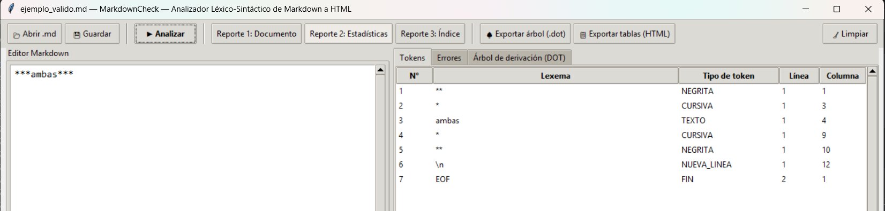

---

#### CP-16 — Caracteres HTML se escapan

**Entrada:**

~~~markdown
a < b & c
~~~

**Resultado esperado:** 0 errores; los caracteres `<` y `&` se escapan en el HTML generado.

**Resultado obtenido:** 3 tokens, **0 errores**.

```html
<p>a &lt; b &amp; c</p>
```

**Estado:** ✓ Aprobado

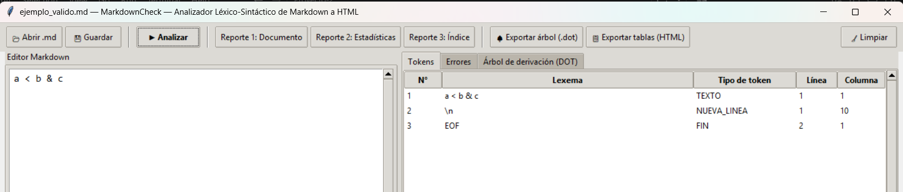

---

#### CP-17 — Múltiples errores en una sola pasada

| | |
|---|---|
| **Objetivo** | Verificar la recuperación en modo pánico: el análisis no se detiene en el primer error y reporta todos |

**Entrada:**

~~~markdown
####### a

**b

>c
~~~

**Resultado esperado:** 3 errores, ordenados por posición: `ENCABEZADO_INVALIDO` (1,1), `NEGRITA_SIN_CERRAR` (3,1) y `CITA_MAL_FORMADA` (5,1). No se generan reportes.

**Resultado obtenido:** 11 tokens, 3 errores:

| N° | Tipo | Fase | Línea | Columna | Descripción |
|---|---|---|---|---|---|
| 1 | `ENCABEZADO_INVALIDO` | Léxico | 1 | 1 | Encabezado inválido en línea 1: máximo 6 niveles |
| 2 | `NEGRITA_SIN_CERRAR` | Léxico | 3 | 1 | Negrita sin cerrar iniciada en línea 3, columna 1 |
| 3 | `CITA_MAL_FORMADA` | Sintáctico | 5 | 1 | Cita mal formada en línea 5, columna 1 |

**Estado:** ✓ Aprobado

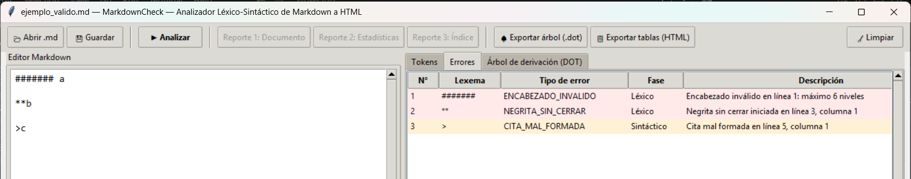

---

#### CP-18 — Regla horizontal entre párrafos

**Entrada:**

~~~markdown
uno

---

dos
~~~

**Resultado esperado:** 0 errores; `<p>`, `<hr>`, `<p>`.

**Resultado obtenido:** 8 tokens, **0 errores**.

```html
<p>uno</p>
<hr>
<p>dos</p>
```

**Estado:** ✓ Aprobado


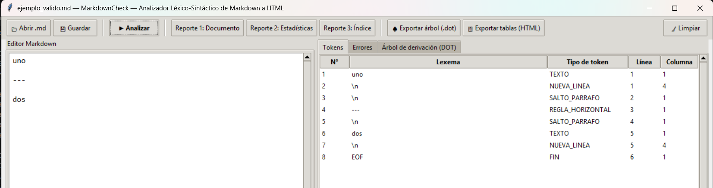

---

## 4. Caso integral con todos los errores

El archivo `examples/ejemplo_con_errores.md` reúne un error de cada tipo (útil para el manual de usuario):

| N° | Tipo | Fase | Línea | Columna |
|---|---|---|---|---|
| 1 | `ENCABEZADO_INVALIDO` | Léxico | 1 | 1 |
| 2 | `NEGRITA_SIN_CERRAR` | Léxico | 3 | 20 |
| 3 | `CURSIVA_SIN_CERRAR` | Léxico | 3 | 51 |
| 4 | `CODIGO_INLINE_SIN_CERRAR` | Léxico | 5 | 10 |
| 5 | `INDENTACION_INVALIDA` | Sintáctico | 8 | 5 |
| 6 | `CITA_MAL_FORMADA` | Sintáctico | 10 | 1 |
| 7 | `BLOQUE_CODIGO_SIN_CERRAR` | Léxico | 12 | 1 |

El análisis completo termina con 32 tokens y los 7 errores, sin detenerse en el primero.

---

## 5. Pruebas automatizadas

| Archivo | Pruebas | Qué verifica |
|---|---|---|
| `test_lexico.py` | 39 | Tokens y prioridades (`**` vs `*`, viñeta vs cursiva), `INDENT`/`DEDENT`, posiciones exactas, modo literal, CRLF/BOM, entrada vacía |
| `test_sintactico.py` | 27 | Estructura del árbol (raíz, ε, terminales), listas y citas anidadas, recursión mutua, modo pánico con un lexer simulado, documento de miles de bloques |
| `test_errores.py` | 28 | Los 7 errores con tipo, fase, mensaje y posición exactos; varios errores en una sola pasada; no se generan reportes con errores |
| `test_reportes.py` | 45 | HTML de cada elemento, estadísticas del ejemplo, Reporte 3 (enlaces, anclas, sangría, sin encabezados), DOT (estructura, colores, aristas, validez con Graphviz), archivos de salida |
| `test_casos_prueba.py` | 4 | Los 18 casos de este documento y el criterio de reconocimiento ≥ 90 % |
| `test_restricciones.py` | 13 | Python 3.10+, ausencia de `re` y de librerías de parsing/Markdown, clases y métodos exigidos, una función por no terminal, recursión mutua, código comentado, y la GUI (se omite sin pantalla) |
| **Total** | **156** | |

**Resultado de la ejecución:** `Ran 156 tests … OK` (con pantalla disponible se ejecutan las 156; sin pantalla se omiten 4 pruebas de la GUI).

### 5.1 Trazabilidad con los requisitos del enunciado

| Requisito | Cubierto por |
|---|---|
| Encabezados `#`–`######`, párrafos, negrita, cursiva, código en línea | `test_lexico.PruebasEncabezados`, `PruebasEnLinea`; CP-01, CP-12, CP-15 |
| Listas con 3+ niveles | `test_lexico.PruebasIndentacion`, `test_sintactico.PruebasListas`; CP-02 |
| Citas con 2+ niveles; `>>` ≡ `> >` | `test_lexico.PruebasMarcadoresDeBloque`, `test_sintactico.PruebasCitas`; CP-03 |
| Bloques de código con contenido literal | `test_lexico.PruebasBloqueCodigo`; CP-13 |
| Regla horizontal | `test_lexico`, `test_reportes`; CP-18 |
| Sin `re` ni librerías de parsing/Markdown | `test_restricciones` |
| `AnalizadorLexico.siguiente_token()` | `test_lexico.PruebasFlujoDeTokens`, `test_restricciones` |
| Parser descendente recursivo, una función por no terminal | `test_restricciones` |
| Árbol de derivación del que se genera el HTML | `test_sintactico`, `test_reportes.PruebasReporte1` |
| Tabla de tokens con línea y columna exactas | `test_lexico.PruebasPosiciones` |
| Tabla de errores con posición exacta y modo pánico | `test_errores`; CP-04 a CP-10, CP-17 |
| Tres reportes HTML con CSS embebido | `test_reportes.PruebasReporte1/2/3`; CP-01 |
| `arbol.dot` con el árbol real, colores distintos | `test_reportes.PruebasGraphviz` |
| Interfaz gráfica con los paneles requeridos | `test_restricciones.PruebasInterfazGrafica` |

---

## 6. Conclusiones

- Los **18 casos funcionales** y las **156 pruebas automatizadas** se ejecutaron con resultado satisfactorio.
- Los **siete tipos de error** del enunciado se detectan con el mensaje sugerido y la posición exacta, y el análisis se recupera y continúa tras cada uno.
- El reconocimiento del documento de ejemplo es del **100 %** (el enunciado exige al menos 90 %), con listas de 3 niveles y citas de 2 niveles.
- Las pruebas de los reportes verifican su **contenido y estructura**; la apariencia visual se comprueba abriéndolos en el navegador (capturas U-10 a U-12 del Manual de Usuario).

---

*Fin del documento de Casos de Prueba.*
