# Manual Técnico — MarkdownCheck

**Analizador léxico-sintáctico de Markdown a HTML**
Lenguajes Formales y de Programación · Proyecto 2 · USAC

| | |
|---|---|
| **Autor** | `Oliver Jorge Raxtún Morales` |
| **Carnet** | `202400634` |
| **Lenguaje** | Python 3.10+ (Tkinter) |
| **Fecha** | `22/10/2026` |

---

## Índice

1. [Introducción](#1-introducción)
2. [Arquitectura del sistema](#2-arquitectura-del-sistema)
3. [Diseño orientado a objetos](#3-diseño-orientado-a-objetos)
4. [Análisis léxico (AFD)](#4-análisis-léxico-afd)
5. [Análisis sintáctico](#5-análisis-sintáctico)
6. [Recuperación de errores](#6-recuperación-de-errores)
7. [Generación de reportes y árbol Graphviz](#7-generación-de-reportes-y-árbol-graphviz)
8. [Flujo de ejecución e interfaz gráfica](#8-flujo-de-ejecución-e-interfaz-gráfica)
9. [Justificación de decisiones de diseño](#9-justificación-de-decisiones-de-diseño)
10. [Limitaciones y trabajo futuro](#10-limitaciones-y-trabajo-futuro)
11. [Estructura del repositorio y ejecución](#11-estructura-del-repositorio-y-ejecución)

---

## 1. Introducción

### 1.1 Objetivo

Diseñar e implementar **desde cero**, sin librerías de parsing ni de conversión Markdown, un analizador léxico-sintáctico en Python con interfaz gráfica, capaz de reconocer la gramática libre de contexto de un subconjunto de Markdown y traducirlo a HTML equivalente.

### 1.2 Alcance implementado

| Requisito del enunciado | Estado |
|---|---|
| Encabezados `#`–`######`, párrafos, negrita, cursiva, código en línea | ✓ |
| Listas no ordenadas con 3+ niveles de anidamiento por indentación | ✓ (profundidad ilimitada) |
| Citas con 2+ niveles de anidamiento | ✓ (profundidad ilimitada) |
| Bloques de código con contenido literal | ✓ |
| Regla horizontal | ✓ |
| `AnalizadorLexico` con `siguiente_token()`, sin `re` | ✓ |
| `AnalizadorSintactico` descendente recursivo, sin librerías de parsing | ✓ |
| Árbol de derivación (AST) del que se genera el HTML (sin regex ni sustitución de texto) | ✓ |
| Tabla de tokens (número, lexema, tipo, línea, columna) | ✓ |
| Tabla de errores (número, lexema, tipo, descripción, posición) con recuperación en modo pánico | ✓ |
| 3 reportes HTML con CSS embebido | ✓ |
| `arbol.dot` con el árbol de derivación real | ✓ |
| Interfaz gráfica Tkinter | ✓ |
| Alcance opcional (listas ordenadas, enlaces, tablas, etc.) | X No implementado |

### 1.3 Requisitos de ejecución

Python 3.10 o superior y Tkinter. Sin dependencias externas. Graphviz es opcional (solo para renderizar `arbol.dot`).

---

## 2. Arquitectura del sistema

### 2.1 Visión general

El sistema es un **pipeline** de cuatro etapas. Cada etapa consume la salida de la anterior y registra sus errores en un `GestorErrores` compartido:

```
texto .md ──► AnalizadorLexico ──► tokens ──► AnalizadorSintactico ──► NodoAST
                  (AFD)                           (descendente              │
                    │                              recursivo)               │
                    └──────────► GestorErrores ◄─────────┘                  ▼
                                                              GeneradorHTML (R1, R2, R3)
                                                              GeneradorDOT  (arbol.dot)
```

El analizador sintáctico **solicita** los tokens bajo demanda llamando a `AnalizadorLexico.siguiente_token()` (con un buffer de anticipación), de modo que ambos componentes trabajan de forma intercalada.

### 2.2 Módulos

| Módulo (`src/`) | Responsabilidad | Clases principales |
|---|---|---|
| `tokens.py` | Catálogo de tokens | `TipoToken`, `Token` |
| `gestor_errores.py` | Acumulación de errores | `TipoError`, `FaseError`, `ErrorAnalisis`, `GestorErrores` |
| `analizador_lexico.py` | AFD léxico | `AnalizadorLexico`, `ClasificacionLinea`, `TipoLinea` |
| `nodo_ast.py` | Árbol de derivación | `NodoAST` |
| `analizador_sintactico.py` | Parser descendente recursivo | `AnalizadorSintactico` |
| `generador_html.py` | Reportes 1, 2, 3 y tablas | `GeneradorHTML` |
| `generador_dot.py` | Código Graphviz | `GeneradorDOT` |
| `procesador.py` | Fachada que encadena las fases | `ProcesadorMarkdown`, `ResultadoAnalisis` |
| `interfaz_grafica.py` | Interfaz Tkinter | `AplicacionMarkdownCheck` |
| `main.py` | Punto de entrada (GUI / consola) | — |


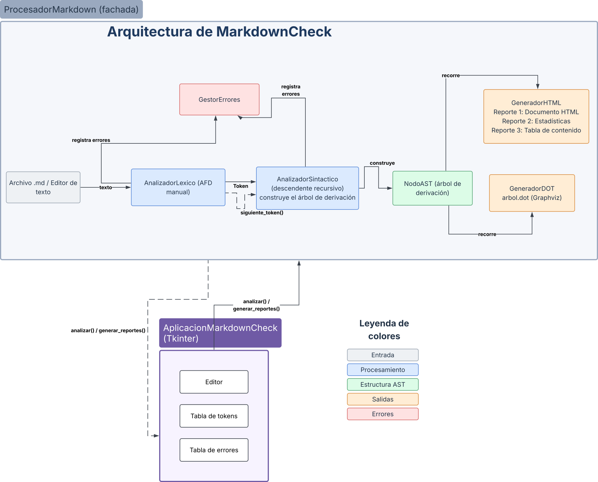

---

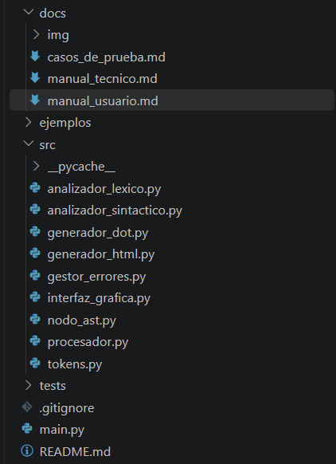

---

## 3. Diseño orientado a objetos

### 3.1 Diagrama de clases

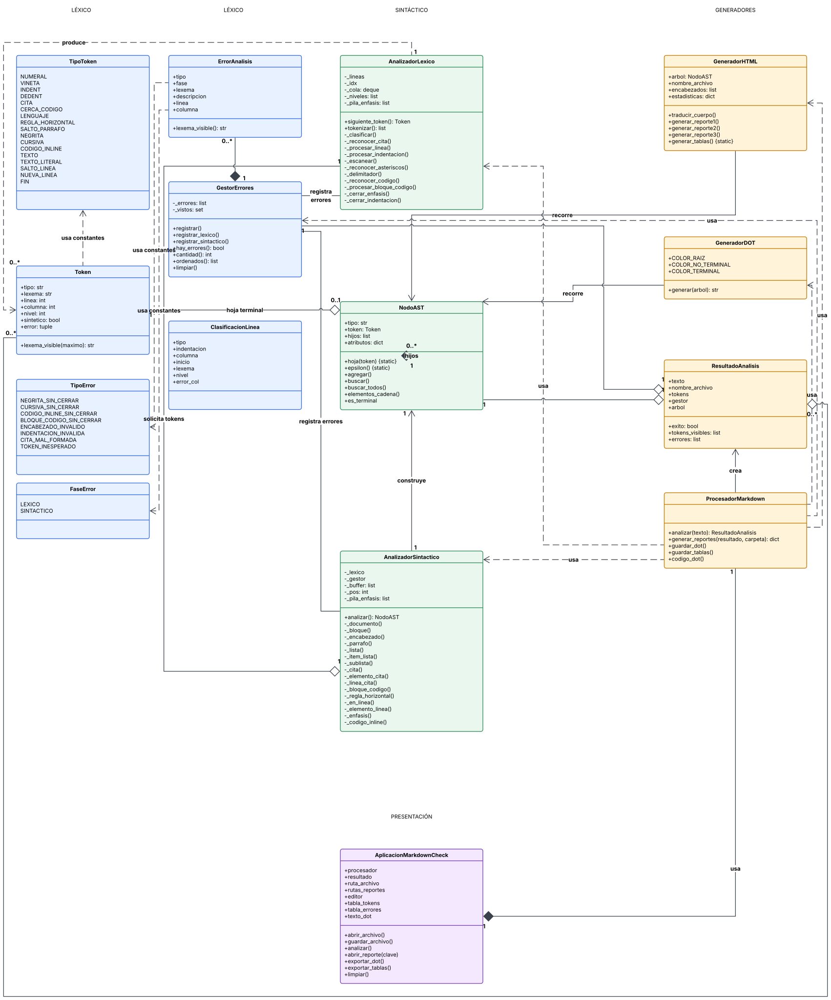

### 3.2 Responsabilidad de cada clase

| Clase | Responsabilidad |
|---|---|
| `Token` | Unidad léxica: tipo, lexema, posición (línea/columna base 1), nivel (encabezado o cita), marca de *sintético* y marca de error diferido. |
| `AnalizadorLexico` | AFD manual. Entrega tokens con `siguiente_token()`. Genera `INDENT`/`DEDENT`, aplica *maximal munch*, modo literal para código, y se recupera de errores léxicos. |
| `NodoAST` | Nodo del árbol de derivación: no terminales (`<lista>`…), terminales (con su `Token`) y `ε`. Incluye `elementos_cadena()` para recorrer producciones recursivas por la derecha sin recursión. |
| `AnalizadorSintactico` | Una función por no terminal. Construye el árbol y registra errores sintácticos con recuperación en modo pánico. |
| `GestorErrores` | Acumula errores (sin duplicados exactos), los ordena por posición y distingue la fase. |
| `GeneradorHTML` | Recorre el árbol: traduce a HTML (Reporte 1), calcula estadísticas (Reporte 2), construye el índice (Reporte 3) y las tablas exportables. |
| `GeneradorDOT` | Recorrido iterativo del árbol que emite el código Graphviz con colores distintos para terminales y no terminales. |
| `ProcesadorMarkdown` | Fachada compartida por la GUI y la consola: encadena las fases y escribe archivos. |
| `AplicacionMarkdownCheck` | Interfaz Tkinter: editor, tablas de tokens y errores, pestaña DOT, apertura de reportes y exportaciones. |


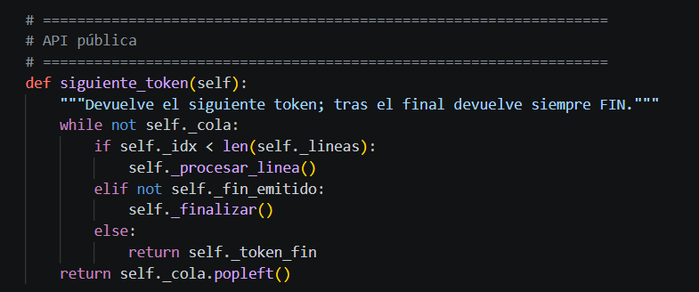

---

## 4. Análisis léxico (AFD)

### 4.1 Tabla de tokens

| Token | Lexema / regla | Ejemplo | Notas |
|---|---|---|---|
| `NUMERAL` | 1 a 6 `#` al inicio de línea seguidos de espacio. `nivel` = cantidad de `#` | `## Título` | `#sinespacio` es `TEXTO`. Más de 6 `#` → error `ENCABEZADO_INVALIDO` |
| `VIÑETA` | `-`, `*` o `+` al inicio de línea (tras la indentación) seguido de espacio | `- Elemento` | Solo en posición inicial; en otra posición `*` es `CURSIVA` |
| `INDENT` | Virtual (sin lexema). Aumento de un nivel de indentación | — | 2 espacios = 1 nivel |
| `DEDENT` | Virtual (sin lexema). Disminución de uno o más niveles | — | Se emite un `DEDENT` por nivel cerrado |
| `CITA` | Uno o más `>` al inicio de línea. `nivel` = cantidad de `>` | `>> texto` | `>>` y `> >` son equivalentes |
| `CERCA_CODIGO` | 3 o más `` ` `` al inicio de línea | ```` ```python ```` | Abre y cierra un bloque |
| `LENGUAJE_CODIGO` | Texto que sigue a la cerca de apertura | `python` | Se usa para `class="language-python"` |
| `REGLA_HORIZONTAL` | 3 o más `-` solos en la línea | `---` | |
| `NEGRITA` | `**` | `**fuerte**` | Prioridad sobre `CURSIVA` (*maximal munch*) |
| `CURSIVA` | `*` fuera de posición de viñeta | `*énfasis*` | |
| `CODIGO_INLINE` | `` ` `` | `` `x` `` | El contenido va como `TEXTO_LITERAL` |
| `TEXTO` | Cualquier secuencia que no contenga delimitadores | `Lenguajes Formales` | |
| `TEXTO_LITERAL` | Contenido sin tokenizar (código en línea o bloque) | `print("hola")` | |
| `SALTO_PARRAFO` | Una o varias líneas en blanco consecutivas | *(línea vacía)* | Se emite **un** token por grupo de líneas vacías |
| `SALTO_LINEA` | Fin de línea **dentro** de un párrafo que continúa | — | Token técnico; permite párrafos de varias líneas |
| `NUEVA_LINEA` | Fin de línea que **termina** un bloque de línea | — | Token técnico; terminador de encabezado, párrafo, ítem y línea de cita |
| `FIN` | Fin de archivo | — | Se repite indefinidamente tras el final |

> Los tokens `SALTO_LINEA`, `NUEVA_LINEA`, `FIN` y `LENGUAJE_CODIGO` son una extensión de la tabla del enunciado (ver §9).

### 4.2 Estructura del AFD

El analizador es un AFD compuesto por **tres sub-autómatas** que trabajan sobre cada línea, más un modo literal. Se procesa línea por línea; la clase `AnalizadorLexico` guarda una cola de tokens listos y `siguiente_token()` procesa líneas hasta tener al menos un token.

| Sub-autómata | Método | Estados | Función |
|---|---|---|---|
| AFD de inicio de línea | `_clasificar()` + `_reconocer_cita()` | `Q_INDENT`, `Q_HASH`, `Q_GUION`, `Q_BULLET`, `Q_TICK`, `Q_CITA` | Decide qué tipo de bloque inicia la línea |
| AFD en línea | `_escanear()` | `Q_TEXTO`, `Q_ASTERISCO`, `Q_CODIGO` | Reconoce `TEXTO`, `NEGRITA`, `CURSIVA`, `CODIGO_INLINE` |
| Modo literal | `_procesar_bloque_codigo()` | `Q_CODIGO_LITERAL` *(estado conceptual: se implementa como un bucle que consume líneas)* | Tras ```` ``` ```` no tokeniza hasta la cerca de cierre |

### 4.3 AFD de inicio de línea

Alfabeto de clases de carácter: `ESPACIO` (espacio o tabulador), `#`, `>`, `-`, `*`/`+`, `` ` ``, `EOL` (fin de línea), `OTRO`. Estado inicial: `Q_INDENT`. Los estados finales indican el tipo de línea reconocido (entre corchetes).

| Estado | Entrada | Siguiente estado / resultado |
|---|---|---|
| `Q_INDENT` | espacio | `Q_INDENT` (acumula 1; tabulador acumula 2) |
| `Q_INDENT` | `EOL` | **[VACIA]** |
| `Q_INDENT` | `#` | `Q_HASH` |
| `Q_INDENT` | `>` | `Q_CITA` |
| `Q_INDENT` | `-` | `Q_GUION` |
| `Q_INDENT` | `*` o `+` | `Q_BULLET` |
| `Q_INDENT` | `` ` `` | `Q_TICK` |
| `Q_INDENT` | otro | **[TEXTO]** |
| `Q_HASH` | `#` | `Q_HASH` (cantidad++) |
| `Q_HASH` | no `#`, cantidad > 6 | **[NUMERAL_INVALIDO]** (error léxico) |
| `Q_HASH` | espacio, cantidad ≤ 6 | **[NUMERAL]** con nivel = cantidad |
| `Q_HASH` | otro / `EOL` | **[TEXTO]** (`#sinespacio`) |
| `Q_GUION` | `-` | `Q_GUION` (cantidad++) |
| `Q_GUION` | espacio, cantidad = 1 | **[VIÑETA]** |
| `Q_GUION` | cantidad ≥ 3 y resto de línea vacío | **[REGLA_HORIZONTAL]** |
| `Q_GUION` | cualquier otro caso | **[TEXTO]** |
| `Q_BULLET` | siguiente carácter es espacio | **[VIÑETA]** |
| `Q_BULLET` | otro | **[TEXTO]** (el `*` se tokenizará luego como `CURSIVA`) |
| `Q_TICK` | `` ` `` | `Q_TICK` (cantidad++) |
| `Q_TICK` | otro, cantidad ≥ 3 | **[CERCA_CODIGO]** |
| `Q_TICK` | otro, cantidad < 3 | **[TEXTO]** |

Sub-autómata de citas (`Q_CITA`), que lee un `>` y examina el siguiente carácter:

| Carácter siguiente al `>` | Acción |
|---|---|
| `>` | Otro nivel de cita (`>>`), continúa |
| espacio(s) seguido(s) de `>` | Otro nivel (`> >`), continúa |
| espacio(s) seguido(s) de otro carácter | **[CITA]** válida; el contenido empieza ahí |
| `EOL` | **[CITA]** vacía (aceptada) |
| cualquier otro carácter (`>texto`) | **[CITA]** con error: se marca la posición del `>` ofensor y el **parser** reporta `CITA_MAL_FORMADA` |

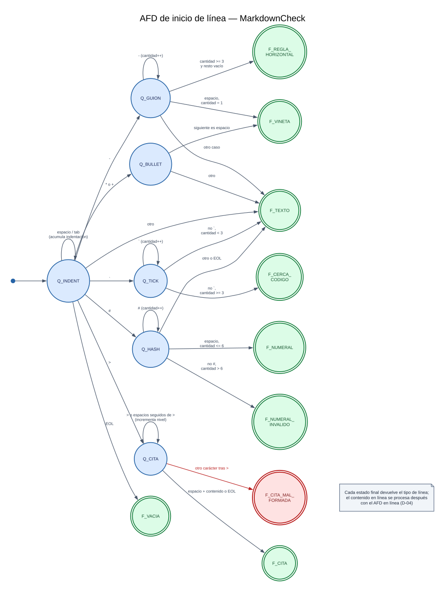

### 4.4 AFD de contenido en línea

El despachador examina el carácter actual y elige un estado:

| Carácter actual | Estado | Comportamiento |
|---|---|---|
| `*` | `Q_ASTERISCO` | Cuenta la racha de `*` (k). Si k ≥ 3 **y** el tope de la pila es `CURSIVA` → `CURSIVA` (1 carácter, cierra primero la cursiva en `***`). Si k ≥ 2 → `NEGRITA` (2 caracteres, *maximal munch*). Si no → `CURSIVA` |
| `` ` `` | `Q_CODIGO` | Emite `CODIGO_INLINE`, lee literalmente hasta el siguiente `` ` `` (mismo renglón), emite `TEXTO_LITERAL` y el `CODIGO_INLINE` de cierre. Si no hay cierre → error `CODIGO_INLINE_SIN_CERRAR` |
| otro | `Q_TEXTO` | Acumula hasta el siguiente `*`, `` ` `` o fin de línea y emite `TEXTO` |

Apertura y cierre de énfasis se deciden con una **pila de delimitadores abiertos** `(tipo, línea, columna)`:

1. Si el delimitador **no** está en la pila → es una **apertura** (se apila).
2. Si **está** en la pila → es un **cierre**. Los énfasis que estén encima (abiertos dentro y sin cerrar) se reportan como error y se les inserta un cierre sintético; luego se desapila el delimitador.
3. Al terminar un **bloque**, todo lo que siga en la pila se reporta como `*_SIN_CERRAR` con la posición de su apertura.

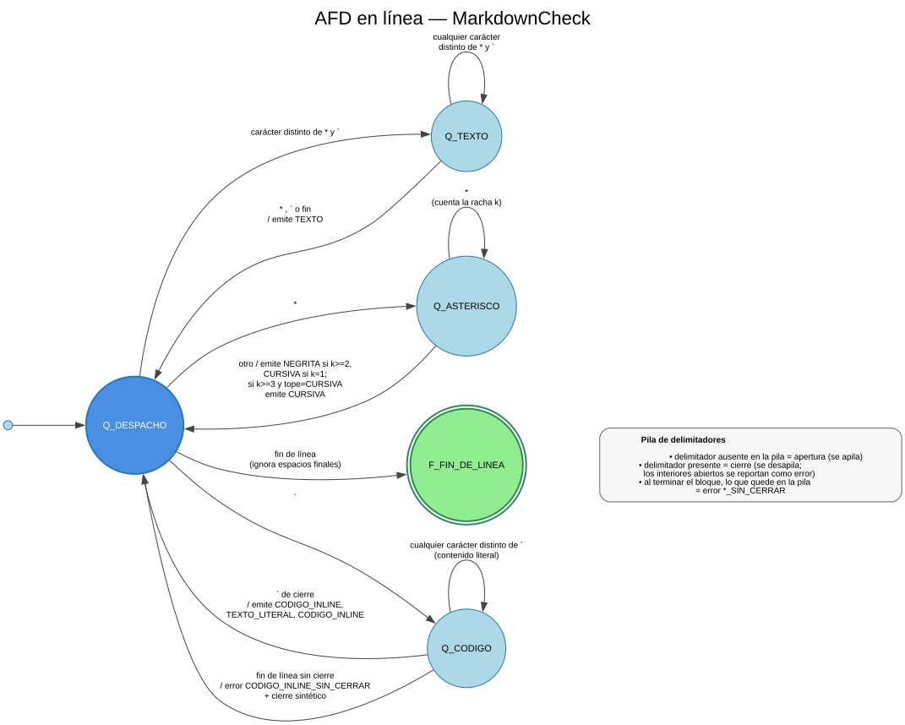

---

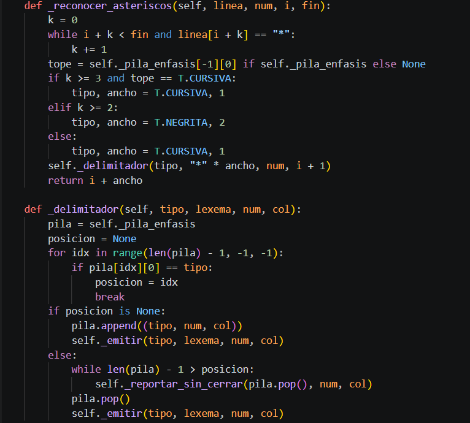

### 4.5 Modo literal y tokens virtuales de indentación

**Modo literal.** Al reconocer una línea `CERCA_CODIGO`, el analizador emite la cerca (y el `LENGUAJE_CODIGO` si existe) y consume líneas **sin tokenizar** hasta encontrar una línea formada solo por 3 o más `` ` ``. Todo el contenido —incluyendo líneas en blanco e indentación— se entrega como **un único** `TEXTO_LITERAL`. Si se llega al fin de archivo sin cierre, se registra `BLOQUE_CODIGO_SIN_CERRAR` y se inserta una cerca de cierre sintética.

**INDENT / DEDENT.** Se mantiene una pila de niveles de la lista actual. El nivel de un ítem es `espacios // 2` (tabulador = 2 espacios):

| Situación al leer un ítem con nivel `L` | Acción |
|---|---|
| Primer ítem de una lista | Se apila `L` como nivel base. Si `L > 1` → indentación inválida |
| `L` = tope de la pila | Ítem hermano: sin tokens virtuales |
| `L` > tope | Se apila `L` y se emite `INDENT`. Si `L − tope > 1` → indentación inválida (salto de más de un nivel) |
| `L` < tope | Se desapila emitiendo un `DEDENT` por nivel hasta alcanzar `L`. Si queda un nivel menor que `L` → indentación inválida |
| `L` < nivel base | Se emiten `DEDENT` hasta la base y se marca indentación inválida |
| Línea que no es viñeta (incluida la vacía) o fin de archivo | Se emiten todos los `DEDENT` pendientes y se reinicia el estado de lista |

Como **2 espacios = 1 nivel con división entera**, el ejemplo del enunciado (indentaciones de 0, 3 y 5 espacios) corresponde a los niveles 0, 1 y 2.

El token `VIÑETA` de un ítem con salto inválido lleva la marca de error `(línea, columna)`. El **parser** la lee al consumir el ítem y registra `INDENTACION_INVALIDA` (fase sintáctica).

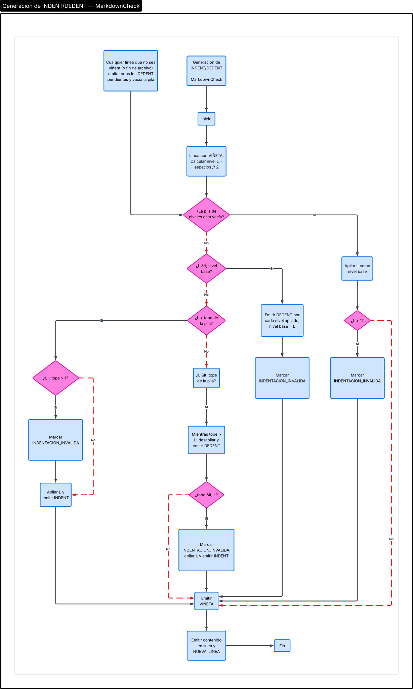

### 4.6 Continuación de párrafos (anticipación de una línea)

Un párrafo puede ocupar varias líneas. Al terminar una línea de texto, el lexer **mira la clasificación de la línea siguiente**:

- Si la siguiente también es texto → emite `SALTO_LINEA` (el párrafo continúa y los énfasis abiertos **siguen abiertos**).
- Si no → cierra los énfasis pendientes (con error si los hay) y emite `NUEVA_LINEA`.

Esto permite que `**abre` / `cierra**` en líneas consecutivas del mismo párrafo sea válido, y que un párrafo termine sin línea en blanco cuando le sigue un encabezado (como en el ejemplo del enunciado).

---

## 5. Análisis sintáctico

### 5.1 Gramática libre de contexto

La gramática de referencia (§4.6 del enunciado) se **refinó** y se justifica en §9. Símbolos terminales en MAYÚSCULAS; `[x]` = opcional; `x*` = cero o más.

```text
<documento>        ::= <bloque> <documento> | SALTO_PARRAFO <documento> | ε
<bloque>           ::= <encabezado> | <parrafo> | <lista> | <cita>
                     | <bloque_codigo> | <regla_horizontal>

<encabezado>       ::= NUMERAL <en_linea> NUEVA_LINEA
<parrafo>          ::= <en_linea> NUEVA_LINEA                 (<en_linea> no vacío)
<regla_horizontal> ::= REGLA_HORIZONTAL
<bloque_codigo>    ::= CERCA_CODIGO [LENGUAJE_CODIGO] [TEXTO_LITERAL] CERCA_CODIGO

<lista>            ::= <item_lista> <lista> | <item_lista>
<item_lista>       ::= VIÑETA <en_linea> NUEVA_LINEA <sublista>*
<sublista>         ::= INDENT <lista> DEDENT

<cita>             ::= <elemento_cita> <cita> | <elemento_cita>
<elemento_cita>    ::= <linea_cita> | <cita>                  (<cita> de un nivel más profundo)
<linea_cita>       ::= CITA <en_linea> NUEVA_LINEA

<en_linea>         ::= <elemento_linea> <en_linea> | ε
<elemento_linea>   ::= <negrita> | <cursiva> | <codigo_inline> | TEXTO | SALTO_LINEA
<negrita>          ::= NEGRITA <en_linea> NEGRITA
<cursiva>          ::= CURSIVA <en_linea> CURSIVA
<codigo_inline>    ::= CODIGO_INLINE [TEXTO_LITERAL] CODIGO_INLINE
```

**Recursividad presente:**

| Tipo | Producciones |
|---|---|
| Recursiva por la derecha (cadenas) | `<documento>`, `<lista>`, `<cita>`, `<en_linea>` |
| Mutua | `<en_linea>` ⇄ `<negrita>` / `<cursiva>` (una negrita contiene cursiva y viceversa) |
| Anidamiento | `<lista>` → `<item_lista>` → `<sublista>` → `<lista>`; `<cita>` → `<elemento_cita>` → `<cita>` |

**Decisión con un token de anticipación (LL(1)):**

| Para decidir… | Se mira el token actual |
|---|---|
| `<bloque>` | `NUMERAL` → encabezado · `VIÑETA` → lista · `CITA` → cita · `CERCA_CODIGO` → bloque de código · `REGLA_HORIZONTAL` → regla · `TEXTO`, `NEGRITA`, `CURSIVA`, `CODIGO_INLINE` → párrafo |
| `<elemento_linea>` | `NEGRITA`, `CURSIVA`, `CODIGO_INLINE`, `TEXTO`, `SALTO_LINEA` |
| `<en_linea>` → ε | cualquier otro token (p. ej. `NUEVA_LINEA`) **o** el delimitador que cierra el énfasis abierto |
| Continuar una `<lista>` | `VIÑETA` |
| `<sublista>*` | `INDENT` |
| Continuar una `<cita>` | `CITA` con `nivel ≥` nivel actual |
| `<elemento_cita>` | `nivel` = nivel actual → `<linea_cita>`; `nivel` > actual → `<cita>` anidada |

### 5.2 Algoritmo del parser descendente recursivo

Hay **una función por símbolo no terminal** (`_documento`, `_bloque`, `_encabezado`, `_parrafo`, `_lista`, `_item_lista`, `_sublista`, `_cita`, `_elemento_cita`, `_linea_cita`, `_bloque_codigo`, `_regla_horizontal`, `_en_linea`, `_elemento_linea`, `_enfasis`, `_codigo_inline`). Cada función:

1. Examina el token actual (`_actual`, con `_mirar(k)` para anticipación).
2. Crea el `NodoAST` de su no terminal.
3. Consume terminales con `_avanzar()` (agregándolos como hojas) e invoca a las funciones de los no terminales que aparecen en la producción.
4. Devuelve el nodo.

Pseudocódigo de las funciones más representativas:

```text
_documento():
    raiz = nodo("<documento>"); nodo_actual = raiz
    repetir:
        t = token actual
        si t es FIN:                     agregar ε a nodo_actual; terminar
        si t es SALTO_PARRAFO:           agregar hoja(t)
        si t inicia un bloque:           agregar _bloque()
        si no:                           registrar TOKEN_INESPERADO; descartar t; continuar   # modo pánico
        siguiente = nodo("<documento>"); nodo_actual.agregar(siguiente); nodo_actual = siguiente
    devolver raiz

_enfasis(nombre, delimitador):            # <negrita> o <cursiva>
    nodo = nodo(nombre); agregar hoja(delimitador de apertura)
    apilar delimitador en la pila del parser
    agregar _en_linea()                   # recursión mutua
    desapilar
    si el token actual es el delimitador: agregar hoja (cierre)
    devolver nodo

_en_linea():
    mientras token actual sea elemento_linea (y no sea el cierre del énfasis abierto):
        agregar _elemento_linea() y encadenar un nuevo <en_linea>
    agregar ε

_cita(nivel):
    repetir:
        agregar _elemento_cita(nivel)
        si el token actual es CITA con nivel >= nivel: encadenar nueva <cita>
        si no: terminar

_elemento_cita(nivel):
    si token.nivel == nivel: devolver _linea_cita()
    si no:                   devolver _cita(nivel + 1)       # recursión directa: cita anidada
```

**Recursión de cola como bucle.** Las producciones recursivas por la derecha (`<documento>`, `<lista>`, `<cita>`, `<en_linea>`) se construyen con un bucle que encadena nodos. El **árbol de derivación resultante es idéntico** al de la recursión literal, pero se evita el límite de recursión de Python en documentos largos (probado con miles de bloques). La recursión real se conserva donde modela anidamiento: `_enfasis` ⇄ `_en_linea`, `_cita` ⇄ `_elemento_cita`.

### 5.3 Construcción del árbol de derivación

- **Nodos internos:** un nodo por cada producción aplicada (`<documento>`, `<bloque>`, `<lista>`, `<item_lista>`, …).
- **Hojas:** un nodo por cada token terminal consumido (conserva el `Token`) y nodos `ε` para producciones vacías.
- **Atributos semánticos** (`atributos`): `nivel` en `<encabezado>`, `<cita>` y `<linea_cita>`; `lenguaje` y `contenido` en `<bloque_codigo>`; `contenido` en `<codigo_inline>`.
- Los generadores de HTML, estadísticas, índice y DOT **solo recorren este árbol**; nunca vuelven a leer el Markdown original.


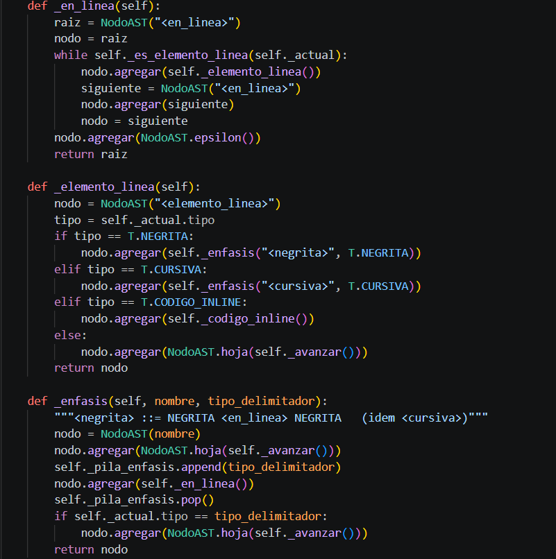

### 5.4 Grafo de llamadas del parser

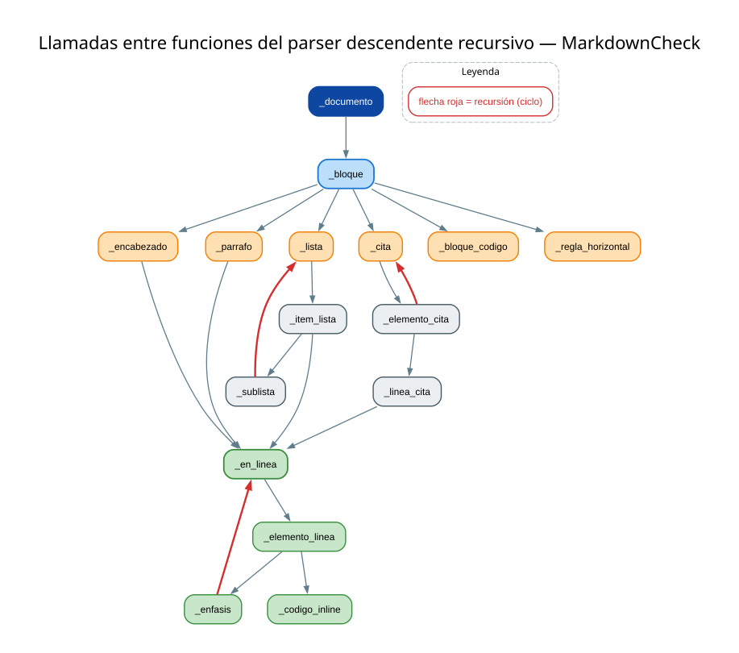

### 5.5 Árbol de derivación de un caso de prueba

Entrada de ejemplo (caso sencillo, sirve para el diagrama):

```markdown
# Hola **mundo**
```

Tokens producidos: `NUMERAL "#"`, `TEXTO "Hola "`, `NEGRITA "**"`, `TEXTO "mundo"`, `NEGRITA "**"`, `NUEVA_LINEA`, `FIN`.

Derivación por la izquierda (resumida):

```text
<documento> ⇒ <bloque> <documento>
            ⇒ <encabezado> <documento>
            ⇒ NUMERAL <en_linea> NUEVA_LINEA <documento>
            ⇒ NUMERAL <elemento_linea> <en_linea> NUEVA_LINEA <documento>
            ⇒ NUMERAL TEXTO <en_linea> NUEVA_LINEA <documento>
            ⇒ NUMERAL TEXTO <elemento_linea> <en_linea> NUEVA_LINEA <documento>
            ⇒ NUMERAL TEXTO <negrita> <en_linea> NUEVA_LINEA <documento>
            ⇒ NUMERAL TEXTO NEGRITA <en_linea> NEGRITA <en_linea> NUEVA_LINEA <documento>
            ⇒ NUMERAL TEXTO NEGRITA TEXTO NEGRITA NUEVA_LINEA <documento>     (los <en_linea> restantes ⇒ ε)
            ⇒ NUMERAL TEXTO NEGRITA TEXTO NEGRITA NUEVA_LINEA                  (<documento> ⇒ ε)
```

Código DOT real generado por la aplicación para esa entrada (se puede pegar en <https://dreampuf.github.io/GraphvizOnline> o renderizar con `dot -Tpng arbol.dot -o arbol.png`):

<details>
<summary><b>Ver código DOT (arbol.dot)</b></summary>

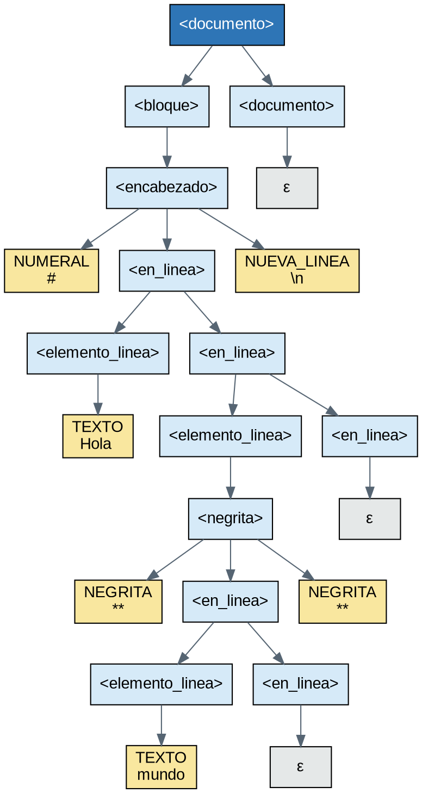

</details>

Paleta usada (igual que el ejemplo del enunciado): raíz `#2E75B6` con texto blanco · no terminales `#D6EAF8` · terminales `#F9E79F` · `ε` en gris `#E5E8E8`.

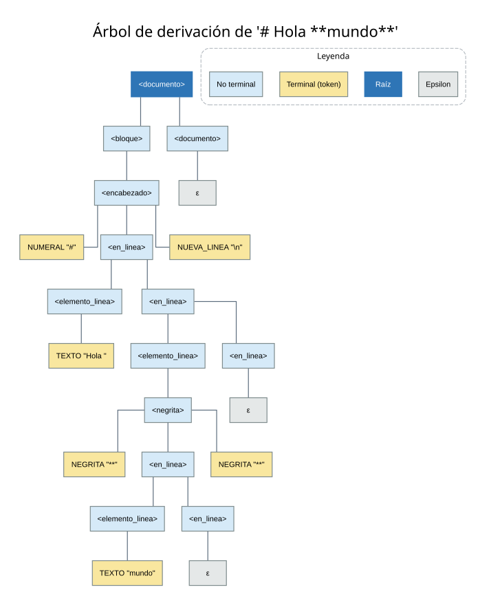

---

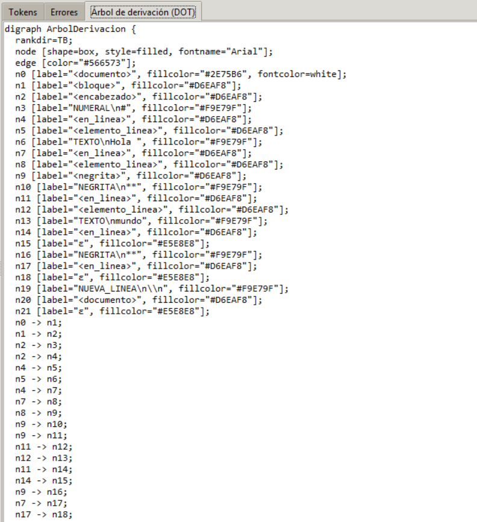
---


---

## 6. Recuperación de errores

El análisis **nunca se detiene** ante un error: cada fase registra el problema en el `GestorErrores` y continúa, de modo que todos los errores se reportan en una sola pasada. Los errores se muestran ordenados por posición. Si hay al menos un error, **no se generan los reportes** (el árbol DOT y las tablas sí).

### 6.1 Tabla de errores

| Tipo | Fase | Dónde se detecta | Mensaje | Posición |
|---|---|---|---|---|
| `NEGRITA_SIN_CERRAR` | Léxico | Fin de bloque con `**` aún abierto | `Negrita sin cerrar iniciada en línea L, columna C` | Apertura |
| `CURSIVA_SIN_CERRAR` | Léxico | Fin de bloque con `*` aún abierto | `Cursiva sin cerrar iniciada en línea L, columna C` | Apertura |
| `CODIGO_INLINE_SIN_CERRAR` | Léxico | Fin de línea sin segundo `` ` `` | `Código en línea sin cerrar iniciado en línea L, columna C` | Apertura |
| `BLOQUE_CODIGO_SIN_CERRAR` | Léxico | Fin de archivo dentro del bloque | `Bloque de código sin cerrar iniciado en línea L` | Cerca de apertura |
| `ENCABEZADO_INVALIDO` | Léxico | Más de 6 `#` al inicio | `Encabezado inválido en línea L: máximo 6 niveles` | Primer `#` |
| `INDENTACION_INVALIDA` | Sintáctico | Lexer marca el ítem; el parser lo reporta | `Indentación inválida en línea L, columna C` | Viñeta del ítem |
| `CITA_MAL_FORMADA` | Sintáctico | Lexer marca el `>`; el parser lo reporta | `Cita mal formada en línea L, columna C` | `>` ofensor |
| `TOKEN_INESPERADO` | Sintáctico | Parser recibe un token que no puede iniciar un bloque | `Token inesperado '…' (TIPO) en línea L, columna C` | Token |

`TOKEN_INESPERADO` es un error adicional de seguridad del parser; con la secuencia de tokens que produce el lexer no debería ocurrir, pero garantiza que el parser siempre avance y termine.

### 6.2 Estrategias

**Léxica — cierres sintéticos.** Cuando un delimitador queda sin cerrar, el lexer registra el error e **inserta un token de cierre sintético** (`sintetico = True`). Así el parser siempre recibe `NEGRITA/CURSIVA/CODIGO_INLINE/CERCA_CODIGO` bien anidados y puede construir un árbol completo. Los tokens sintéticos **no aparecen** en la tabla de tokens (no existen en el texto).

**Sintáctica — modo pánico.** Si el parser encuentra un token que no puede iniciar un bloque, registra `TOKEN_INESPERADO`, **descarta ese token** y continúa con el siguiente. Cada iteración del bucle principal consume al menos un token, por lo que no hay bucles infinitos.

**Errores diferidos.** `INDENTACION_INVALIDA` y `CITA_MAL_FORMADA` se detectan en el lexer (que conoce los espacios y los `>`), pero se **marcan en el token** y los reporta el parser al consumirlo, de modo que su fase sea *Sintáctico* como pide el enunciado. El análisis continúa tratando la viñeta/cita como válida.

**Sin duplicados.** El `GestorErrores` ignora errores repetidos con el mismo tipo y posición.

### 6.3 Flujo de recuperación

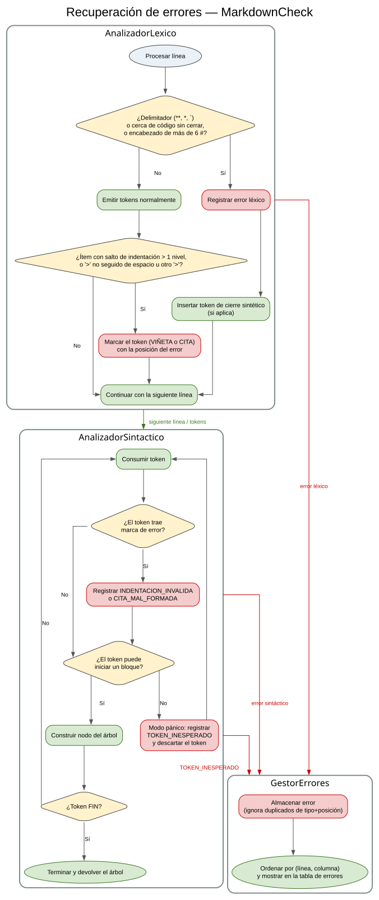

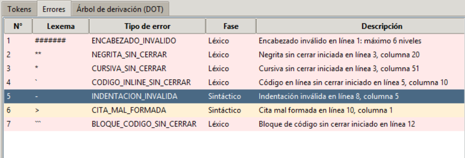

---

## 7. Generación de reportes y árbol Graphviz

Todos los reportes se generan **recorriendo el árbol de derivación**; no hay sustitución de texto ni expresiones regulares sobre el Markdown. El HTML escapa `& < > " '` carácter por carácter.

| Reporte | Archivo | Generado por | Contenido |
|---|---|---|---|
| 1 | `reporte1_documento.html` | `GeneradorHTML.generar_reporte1()` | Traducción completa a HTML semántico + insignia «✓ Análisis completado sin errores» |
| 2 | `reporte2_estadisticas.html` | `GeneradorHTML.generar_reporte2()` | Tarjetas de totales, barras por nivel de encabezado, profundidades, elementos en línea |
| 3 | `reporte3_indice.html` | `GeneradorHTML.generar_reporte3()` | Índice con enlaces `reporte1_documento.html#seccion-N`, sangría según el nivel |
| — | `arbol.dot` | `GeneradorDOT.generar()` | Código Graphviz del árbol |

### 7.1 Traducción a HTML (Reporte 1)

| Nodo del árbol | HTML |
|---|---|
| `<encabezado>` (nivel n) | `<hN id="seccion-k">…</hN>` |
| `<parrafo>` | `<p>…</p>` (los `SALTO_LINEA` se conservan como salto de línea) |
| `<lista>` / `<item_lista>` / `<sublista>` | `<ul>` / `<li>` con los `<ul>` anidados **dentro** del `<li>` del padre |
| `<cita>` | `<blockquote>` con una `<p>` por línea; las citas de nivel mayor son `<blockquote>` anidados |
| `<bloque_codigo>` | `<pre><code class="language-x">…</code></pre>` (contenido literal escapado) |
| `<regla_horizontal>` | `<hr>` |
| `<negrita>` / `<cursiva>` / `<codigo_inline>` | `<strong>` / `<em>` / `<code>` (se pueden combinar y anidar) |

### 7.2 Estadísticas (Reporte 2)

Se calculan en una única pasada sobre el árbol (`GeneradorHTML._recolectar`).

| Métrica | Cómo se calcula |
|---|---|
| Palabras totales | Palabras (separadas por espacio) del texto visible de encabezados, párrafos, ítems y líneas de cita, incluyendo código en línea y la etiqueta de lenguaje de los bloques de código. El contenido literal del bloque de código no se cuenta |
| Párrafos | Cantidad de nodos `<parrafo>` |
| Encabezados por nivel | Contador por nivel 1–6; las barras son proporcionales al máximo |
| Listas / ítems | Listas de nivel superior / todos los `<item_lista>` (incluye anidados) |
| Profundidad de listas | Máxima profundidad de `<sublista>` anidadas + 1 |
| Citas / líneas de cita | Citas de nivel superior / todos los `<linea_cita>` |
| Profundidad de citas | Máximo `nivel` de los nodos `<cita>` |
| Bloques de código, negritas, cursivas, código en línea, reglas | Contadores de nodos |

### 7.3 Tabla de contenido (Reporte 3)

Se construye **solo** con los encabezados recolectados, en orden. Cada entrada es `<a href="reporte1_documento.html#seccion-N">`; los `id` coinciden con los que escribe el Reporte 1. La sangría es `(nivel − 1) × 22 px`. Si el documento no tiene encabezados, el reporte lo indica explícitamente.

### 7.4 Árbol DOT

Recorrido en **preorden iterativo** (los árboles de documentos largos son profundos). Cada nodo recibe un identificador `nK`; los terminales muestran `TIPO\nlexema` (truncado a 28 caracteres). Los tokens sintéticos se rotulan «(cierre implícito)».

---

## 8. Flujo de ejecución e interfaz gráfica

### 8.1 Secuencia de un análisis

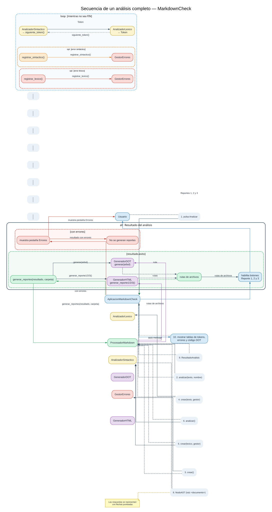

### 8.2 Interfaz gráfica (Tkinter)

| Componente | Descripción |
|---|---|
| Barra de herramientas | **Abrir .md**, **Guardar**, **Analizar**, **Reporte 1/2/3**, **Exportar árbol (.dot)**, **Exportar tablas (HTML)**, **Limpiar** |
| Editor Markdown | Panel izquierdo; permite escribir, pegar o abrir un archivo |
| Pestaña **Tokens** | N°, Lexema, Tipo de token, Línea, Columna. Al seleccionar una fila se resalta el lexema en el editor |
| Pestaña **Errores** | N°, Lexema, Tipo de error, Fase, Descripción, Línea, Columna. Al seleccionar una fila se marca la posición en rojo en el editor |
| Pestaña **Árbol de derivación (DOT)** | Código Graphviz generado |
| Barra de estado | Resumen del análisis (tokens, errores, carpeta de reportes) |

Los botones de reportes están deshabilitados hasta que se completa un análisis **sin errores**. Los reportes se escriben en la carpeta `reportes/` junto al archivo abierto (o en el directorio de trabajo si el texto se escribió en el editor). **Exportar árbol** guarda el `.dot` y, si Graphviz (`dot`) está en el PATH, genera también el PNG.

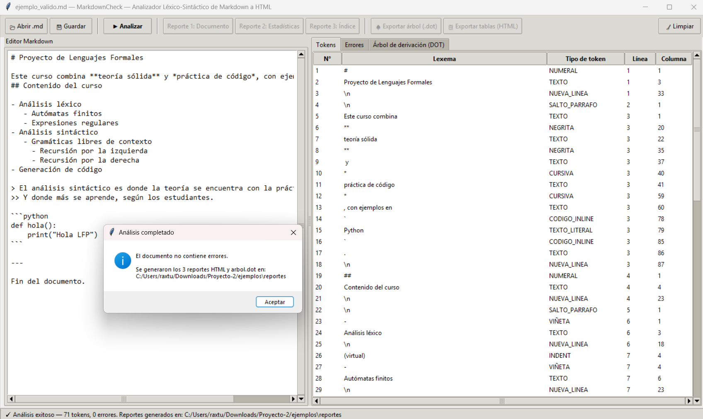


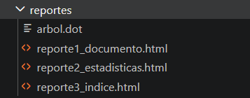

### 8.3 Modo consola

`python src/main.py archivo.md --consola [--salida carpeta]` ejecuta el mismo `ProcesadorMarkdown` sin interfaz: imprime la cantidad de tokens y, si hay errores, la lista de errores (código de salida `1`); si no hay errores, escribe los reportes y `arbol.dot` (código de salida `0`).

---

## 9. Justificación de decisiones de diseño

| # | Decisión | Justificación |
|---|---|---|
| 1 | **AFD de dos niveles** (inicio de línea + en línea) en vez de un único autómata sobre todo el texto | Los marcadores de bloque (`#`, `-`, `>`, ```` ``` ````) solo son significativos al inicio de línea; separarlos evita confundir `*` viñeta con `*` cursiva y simplifica `INDENT/DEDENT` |
| 2 | **Procesamiento por línea con cola de tokens** | Un solo carácter/línea puede producir varios tokens (p. ej. `DEDENT` ×2 + `VIÑETA`); la cola mantiene `siguiente_token()` simple |
| 3 | **Tokens extra** `NUEVA_LINEA`, `SALTO_LINEA`, `FIN`, `LENGUAJE_CODIGO` | Hacen la gramática LL(1) y permiten párrafos de varias líneas y la etiqueta `class="language-x"`. `NUEVA_LINEA`/`SALTO_LINEA` distinguen «termina el bloque» de «el párrafo continúa» sin anticipación en el parser |
| 4 | **Anticipación de una línea en el lexer** | Necesaria para decidir si un énfasis abierto puede continuar en la línea siguiente (mismo párrafo) o ya es un error |
| 5 | **Gramática refinada** (§5.1) | `<parrafo>` termina con `NUEVA_LINEA` y no exige `SALTO_PARRAFO` (el ejemplo del enunciado tiene un párrafo seguido directamente por un encabezado); se agregó `SALTO_PARRAFO <documento>`; `<cita>` se reformuló con `<elemento_cita>`/`<linea_cita>` para anidar por nivel; bloque de código y código en línea admiten contenido vacío |
| 6 | **Nivel de indentación = `espacios // 2`** | El ejemplo del enunciado usa 3 y 5 espacios y debe ser válido; con división entera equivalen a los niveles 1 y 2, y un salto de más de un nivel sigue siendo detectable |
| 7 | **Cierres sintéticos en el lexer** | Mantienen el flujo de tokens bien anidado tras un error, de modo que el parser construye un árbol completo y puede seguir reportando errores sintácticos |
| 8 | **`INDENTACION_INVALIDA` y `CITA_MAL_FORMADA` reportados por el parser** | El enunciado los clasifica como errores de fase sintáctica; el lexer solo los marca en el token |
| 9 | **Recursión de cola como bucle** | Genera el mismo árbol de derivación y evita el `RecursionError` en documentos largos |
| 10 | **Un único árbol para todo** | Un solo recorrido de datos para HTML, estadísticas, índice y DOT; cumple la restricción de no traducir por sustitución de texto |
| 11 | **Reportes solo si no hay errores** | Lo exige el enunciado (§4.8); el DOT y las tablas se generan siempre para ayudar a depurar |
| 12 | **Fachada `ProcesadorMarkdown`** | La GUI y la consola comparten la lógica; las pruebas automatizadas pueden usar el núcleo sin interfaz |
| 13 | **Palabras totales incluye la etiqueta de lenguaje del bloque de código** | Con esa regla el ejemplo del enunciado produce los 67 palabras de la imagen de referencia del Reporte 2 |
| 14 | **Sin dependencias externas** | Cumple las restricciones del proyecto y facilita la ejecución en cualquier equipo con Python 3.10+ |

---

## 10. Limitaciones y trabajo futuro

**Limitaciones conocidas**

- Las citas solo contienen texto en línea (no listas, encabezados ni bloques de código dentro de una cita).
- Una línea en blanco termina la lista; una lista con líneas en blanco entre ítems se interpreta como varias listas.
- El código en línea debe cerrarse en la misma línea. Negrita y cursiva pueden cruzar líneas **solo dentro del mismo párrafo**.
- No hay secuencias de escape (`\*`, `\#`).
- Un `*` aislado rodeado de espacios (p. ej. `2 * 3`) se interpreta como apertura de cursiva y, si no se cierra, produce `CURSIVA_SIN_CERRAR`, conforme a la regla del enunciado.

**Trabajo futuro (alcance opcional):** listas ordenadas, enlaces e imágenes, tablas, texto tachado y listas de tareas, vista previa HTML en vivo dentro de la GUI, advertencia por profundidad de anidamiento configurable y resaltado de sintaxis en los bloques de código del Reporte 1.

---

## 11. Estructura del repositorio y ejecución

```text
MarkdownCheck/
├── src/        código fuente (10 módulos, ~2 150 líneas)
├── tests/      156 pruebas automatizadas (unittest)
├── examples/   ejemplo_valido.md, ejemplo_con_errores.md
├── docs/       manual_tecnico.md, manual_usuario.md, casos_de_prueba.md, img/
├── .gitignore
└── README.md
```

```bash
python src/main.py                                   # interfaz gráfica
python src/main.py examples/ejemplo_valido.md        # GUI con archivo cargado
python src/main.py examples/ejemplo_valido.md --consola --salida reportes
python -m unittest discover -s tests -v              # pruebas
```

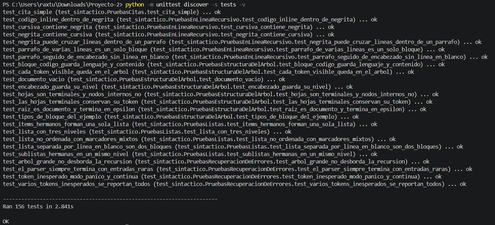

---

*Fin del Manual Técnico.*
