# Manual de Usuario — MarkdownCheck

**Analizador léxico-sintáctico de Markdown a HTML**
Lenguajes Formales y de Programación · Proyecto 2 · USAC

| | |
|---|---|
| **Autor** | `Oliver Jorge Raxtún morales` |
| **Carnet** | `202400634` |

---

## Guía de capturas pendientes

Este manual está completo en texto. Falta insertar **15 capturas de pantalla**. Cada espacio está marcado con un recuadro `📸` que indica **qué capturar** y el **nombre de archivo sugerido** dentro de `docs/img/`. Si guarda cada imagen con ese nombre, la línea `` que sigue al recuadro la mostrará automáticamente.

| ID | Sección | Qué capturar |
|---|---|---|
| U-01 | 2.2 | Terminal ejecutando `python src/main.py` |
| U-02 | 3 | Ventana principal vacía |
| U-03 | 4.1 | Diálogo «Abrir documento Markdown» |
| U-04 | 4.2 | Editor con `ejemplo_valido.md` cargado |
| U-05 | 4.3 | Mensaje de análisis completado |
| U-06 | 5.1 | Pestaña **Tokens** |
| U-07 | 5.2 | Pestaña **Errores** (documento con errores) |
| U-08 | 5.2 | Error resaltado en el editor |
| U-09 | 5.3 | Pestaña **Árbol de derivación (DOT)** |
| U-10 | 6.1 | Reporte 1 en el navegador |
| U-11 | 6.2 | Reporte 2 en el navegador |
| U-12 | 6.3 | Reporte 3 en el navegador |
| U-13 | 7.1 | Diálogo/mensaje de exportación del árbol |
| U-14 | 7.2 | Tablas exportadas (HTML) en el navegador |
| U-15 | 7.3 | Ejecución en modo consola |

---

## Índice

1. [¿Qué es MarkdownCheck?](#1-qué-es-markdowncheck)
2. [Instalación y ejecución](#2-instalación-y-ejecución)
3. [Conociendo la interfaz](#3-conociendo-la-interfaz)
4. [Cargar y analizar un documento](#4-cargar-y-analizar-un-documento)
5. [Interpretar los resultados](#5-interpretar-los-resultados)
6. [Los tres reportes HTML](#6-los-tres-reportes-html)
7. [Otras funciones](#7-otras-funciones)
8. [Sintaxis Markdown soportada](#8-sintaxis-markdown-soportada)
9. [Solución de problemas](#9-solución-de-problemas)

---

## 1. ¿Qué es MarkdownCheck?

MarkdownCheck es una aplicación de escritorio que **lee un documento escrito en Markdown**, comprueba que esté bien formado y lo **traduce a HTML**. Si el documento tiene errores (por ejemplo, una negrita sin cerrar), los lista con su **posición exacta** para que pueda corregirlos.

Con un documento correcto, la aplicación genera automáticamente:

| Salida | Para qué sirve |
|---|---|
| **Reporte 1** | El documento convertido a HTML, listo para abrir en el navegador |
| **Reporte 2** | Estadísticas: palabras, párrafos, encabezados por nivel, profundidad de listas y citas… |
| **Reporte 3** | Tabla de contenido con enlaces a cada sección del Reporte 1 |
| **arbol.dot** | Árbol de derivación en formato Graphviz |

---

## 2. Instalación y ejecución

### 2.1 Requisitos

| Requisito | Detalle |
|---|---|
| Python | Versión **3.10 o superior** (<https://www.python.org/downloads/>) |
| Tkinter | Viene incluido con Python en Windows y macOS. En Linux: `sudo apt install python3-tk` |
| Navegador web | Para abrir los reportes (Chrome, Firefox, Edge…) |
| Graphviz *(opcional)* | Solo si desea convertir `arbol.dot` a imagen |

No es necesario instalar librerías con `pip`.

Para comprobar su versión de Python:

```bash
python --version
```

### 2.2 Ejecutar la aplicación

1. Abra una terminal en la carpeta del proyecto (`MarkdownCheck`).
2. Ejecute:

```bash
python src/main.py
```

En Windows también puede usar `py src/main.py`.


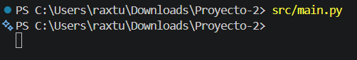

Para abrir la aplicación **con un archivo ya cargado**:

```bash
python src/main.py examples/ejemplo_valido.md
```

---

## 3. Conociendo la interfaz

Al iniciar verá la ventana principal dividida en tres zonas.

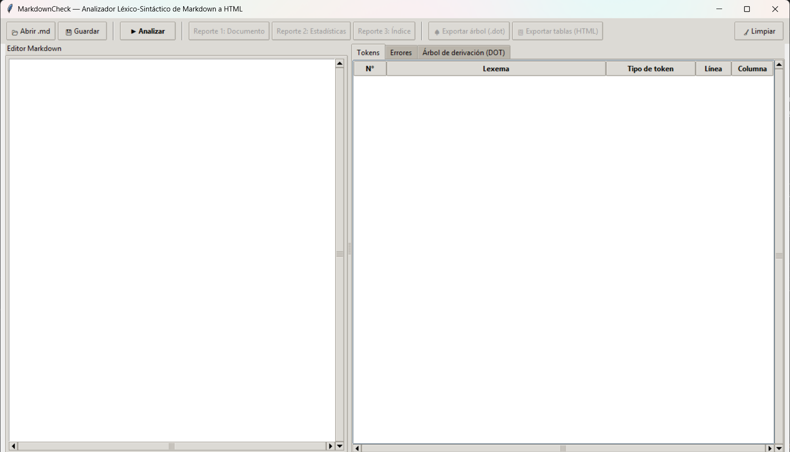

| Zona | Elementos |
|---|---|
| **Barra de herramientas** (arriba) | **Abrir .md** · **Guardar** · **Analizar** · **Reporte 1: Documento** · **Reporte 2: Estadísticas** · **Reporte 3: Índice** · **Exportar árbol (.dot)** · **Exportar tablas (HTML)** · **Limpiar** |
| **Editor Markdown** (izquierda) | Aquí se escribe, pega o carga el documento |
| **Pestañas de resultados** (derecha) | **Tokens** · **Errores** · **Árbol de derivación (DOT)** |
| **Barra de estado** (abajo) | Resumen del último análisis |

> Los botones **Reporte 1 / 2 / 3** permanecen **deshabilitados** hasta que se analiza un documento **sin errores**. Los botones de exportación se habilitan tras cualquier análisis.

---

## 4. Cargar y analizar un documento

### 4.1 Abrir un archivo

1. Pulse **Abrir .md**.
2. Seleccione un archivo `.md`, `.markdown` o `.txt` (por ejemplo `examples/ejemplo_valido.md`).
3. Pulse **Abrir**.

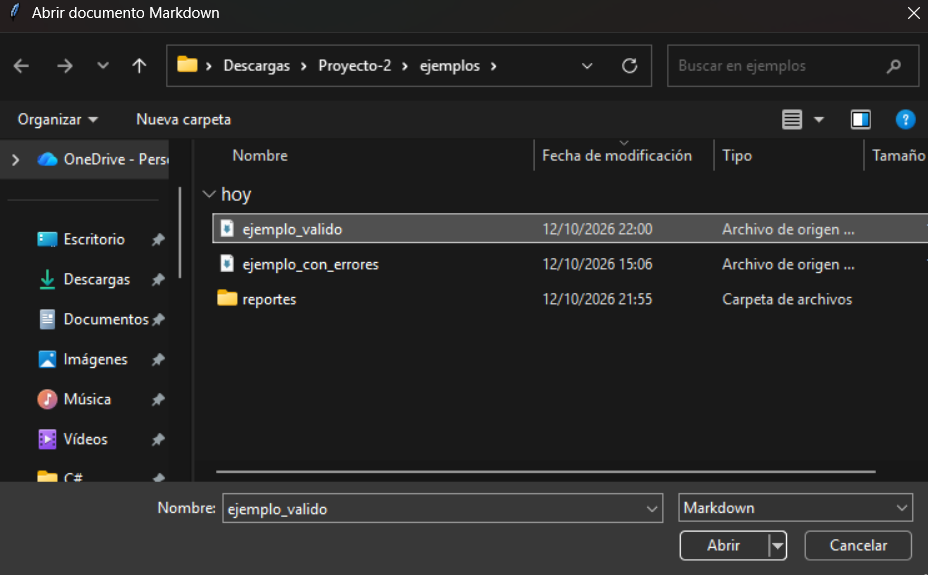

También puede **escribir o pegar** el texto directamente en el editor.

### 4.2 Revisar el contenido cargado

El contenido aparece en el editor y el título de la ventana muestra el nombre del archivo.

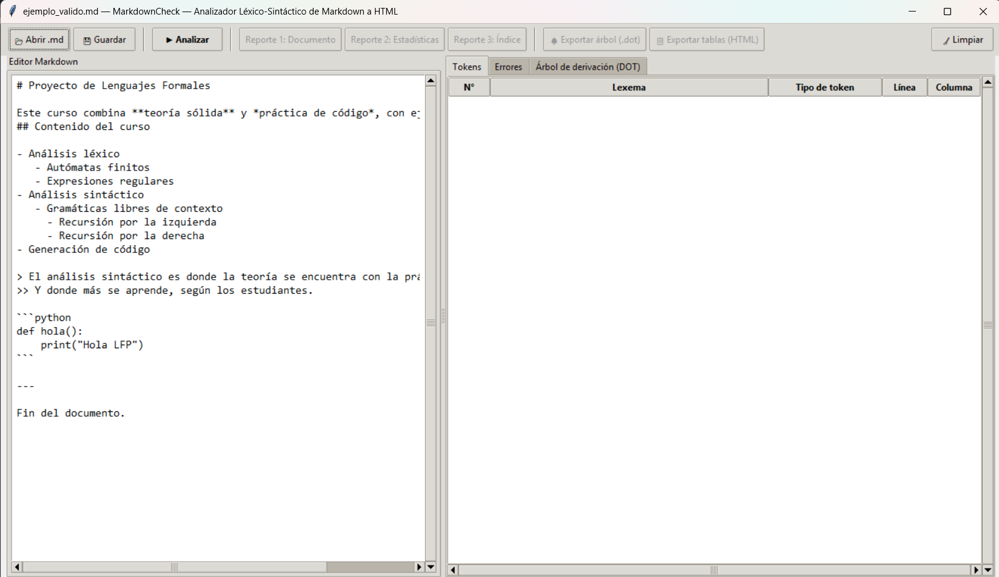

Documento de ejemplo (`examples/ejemplo_valido.md`):

````markdown
# Proyecto de Lenguajes Formales

Este curso combina **teoría sólida** y *práctica de código*, con ejemplos en `Python`.
## Contenido del curso

- Análisis léxico
   - Autómatas finitos
   - Expresiones regulares
- Análisis sintáctico
   - Gramáticas libres de contexto
     - Recursión por la izquierda
     - Recursión por la derecha
- Generación de código

> El análisis sintáctico es donde la teoría se encuentra con la práctica.
>> Y donde más se aprende, según los estudiantes.

```python
def hola():
    print("Hola LFP")
```

---

Fin del documento.
````

### 4.3 Analizar

Pulse **Analizar**. Según el resultado:

| Resultado | Qué ocurre |
|---|---|
| **Sin errores** | Aparece el mensaje «Análisis completado», se generan los 3 reportes y `arbol.dot` en la carpeta `reportes/`, se habilitan los botones **Reporte 1/2/3** y se muestra la pestaña **Tokens** |
| **Con errores** | Aparece una advertencia con la cantidad de errores y se muestra la pestaña **Errores**. **No** se generan los reportes |

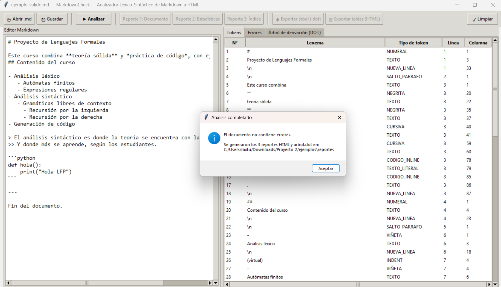

---

## 5. Interpretar los resultados

### 5.1 Tabla de tokens

La pestaña **Tokens** lista, en orden, cada unidad léxica reconocida.

| Columna | Significado |
|---|---|
| **N°** | Número correlativo del token |
| **Lexema** | Texto exacto reconocido (los saltos de línea se muestran como `\n`; `INDENT`/`DEDENT` aparecen como «(virtual)») |
| **Tipo de token** | Clasificación del token (ver tabla siguiente) |
| **Línea** / **Columna** | Posición exacta en el documento (ambas empiezan en 1) |

Al **seleccionar una fila**, el lexema correspondiente se resalta en amarillo en el editor.

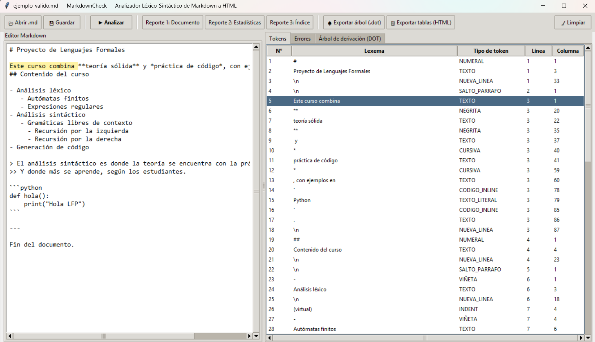

**Tipos de token que verá:**

| Tipo | Qué representa |
|---|---|
| `NUMERAL` | Marcador de encabezado (`#`, `##`, …) |
| `VIÑETA` | Marcador de ítem de lista (`-`, `*`, `+`) |
| `INDENT` / `DEDENT` | Entrada / salida de un nivel de sublista (sin texto visible) |
| `CITA` | Marcador de cita (`>`, `>>`) |
| `CERCA_CODIGO` / `LENGUAJE_CODIGO` | Cercas de un bloque de código y su lenguaje |
| `REGLA_HORIZONTAL` | Línea `---` |
| `NEGRITA` / `CURSIVA` / `CODIGO_INLINE` | Delimitadores `**`, `*` y `` ` `` |
| `TEXTO` / `TEXTO_LITERAL` | Texto normal / contenido de código sin interpretar |
| `SALTO_PARRAFO` | Línea en blanco |
| `NUEVA_LINEA` / `SALTO_LINEA` / `FIN` | Marcadores internos de fin de línea y de fin de archivo |

### 5.2 Tabla de errores

La pestaña **Errores** aparece al analizar un documento con problemas. Para probarla, cargue `examples/ejemplo_con_errores.md` y pulse **Analizar**.

| Columna | Significado |
|---|---|
| **N°** | Número del error (ordenados por posición) |
| **Lexema** | Fragmento que originó el error |
| **Tipo de error** | Ver tabla siguiente |
| **Fase** | `Léxico` (fondo rosado) o `Sintáctico` (fondo naranja) |
| **Descripción** | Mensaje con la línea y la columna |
| **Línea** / **Columna** | Posición exacta |

Resultado esperado con `ejemplo_con_errores.md` (7 errores, uno de cada tipo):

| N° | Tipo | Fase | Descripción |
|---|---|---|---|
| 1 | `ENCABEZADO_INVALIDO` | Léxico | Encabezado inválido en línea 1: máximo 6 niveles |
| 2 | `NEGRITA_SIN_CERRAR` | Léxico | Negrita sin cerrar iniciada en línea 3, columna 20 |
| 3 | `CURSIVA_SIN_CERRAR` | Léxico | Cursiva sin cerrar iniciada en línea 3, columna 51 |
| 4 | `CODIGO_INLINE_SIN_CERRAR` | Léxico | Código en línea sin cerrar iniciado en línea 5, columna 10 |
| 5 | `INDENTACION_INVALIDA` | Sintáctico | Indentación inválida en línea 8, columna 5 |
| 6 | `CITA_MAL_FORMADA` | Sintáctico | Cita mal formada en línea 10, columna 1 |
| 7 | `BLOQUE_CODIGO_SIN_CERRAR` | Léxico | Bloque de código sin cerrar iniciado en línea 12 |

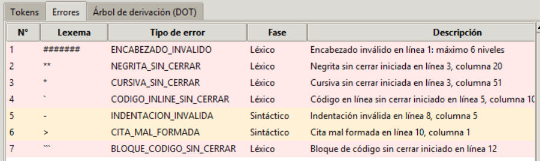

Al **seleccionar una fila** de la tabla de errores, la posición del problema se **marca en rojo** en el editor y la vista se desplaza hasta ella.

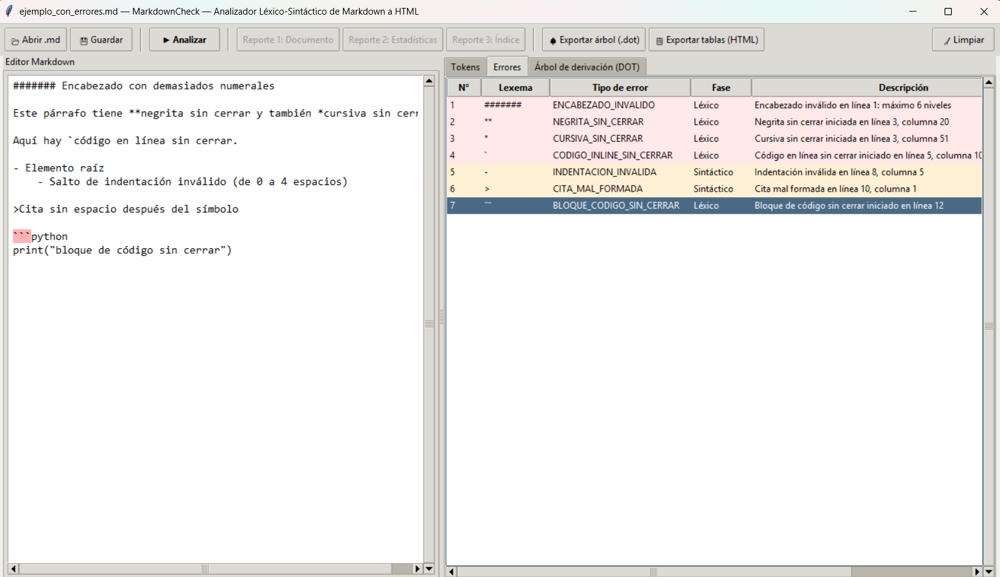

**Tipos de error:**

| Tipo | Causa | Cómo corregirlo |
|---|---|---|
| `NEGRITA_SIN_CERRAR` | Se abrió `**` y el bloque terminó sin cerrarlo | Agregar el `**` de cierre |
| `CURSIVA_SIN_CERRAR` | Se abrió `*` y el bloque terminó sin cerrarlo | Agregar el `*` de cierre |
| `CODIGO_INLINE_SIN_CERRAR` | Se abrió `` ` `` y la línea terminó sin cerrarlo | Agregar el `` ` `` de cierre |
| `BLOQUE_CODIGO_SIN_CERRAR` | Se abrió ```` ``` ```` y el archivo terminó sin la cerca de cierre | Agregar una línea ```` ``` ```` al final del bloque |
| `ENCABEZADO_INVALIDO` | Más de 6 símbolos `#` al inicio de línea | Usar entre 1 y 6 `#` |
| `INDENTACION_INVALIDA` | Un ítem de lista aumenta su sangría en más de un nivel (por ejemplo de 0 a 4 espacios) | Usar 2 espacios más que el ítem anterior |
| `CITA_MAL_FORMADA` | Un `>` no está seguido de un espacio ni de otro `>` | Escribir `> texto` (con espacio) |

Los errores se **acumulan**: la aplicación no se detiene en el primero, así que puede corregir todos de una sola vez y volver a analizar.

### 5.3 Árbol de derivación (DOT)

La pestaña **Árbol de derivación (DOT)** muestra el código Graphviz del árbol que construyó el analizador. Está disponible tras cualquier análisis (incluso con errores).

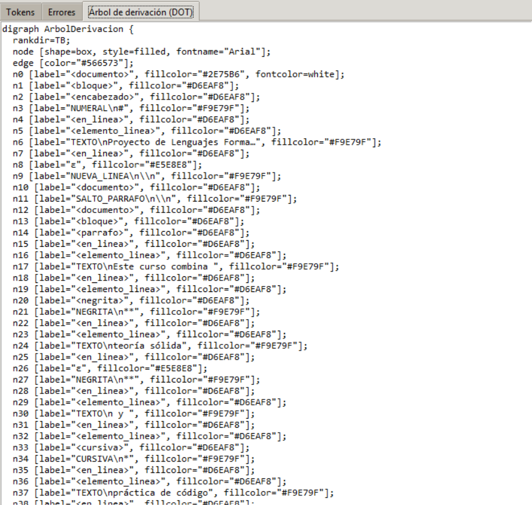

---

## 6. Los tres reportes HTML

Tras un análisis **sin errores**, los botones de reporte se habilitan. Cada uno abre el archivo en su navegador predeterminado. Los archivos están en la carpeta `reportes/` (junto al archivo abierto; si escribió el texto en el editor, en el directorio desde donde ejecutó el programa):

| Archivo | Botón |
|---|---|
| `reportes/reporte1_documento.html` | **Reporte 1: Documento** |
| `reportes/reporte2_estadisticas.html` | **Reporte 2: Estadísticas** |
| `reportes/reporte3_indice.html` | **Reporte 3: Índice** |

Los reportes son archivos independientes con estilos incluidos: puede copiarlos, enviarlos o abrirlos sin la aplicación.

### 6.1 Reporte 1 — Documento HTML

Muestra el documento traducido: encabezados, párrafos con **negrita**, *cursiva* y `código`, listas anidadas, citas anidadas, el bloque de código tal cual y la regla horizontal. En la parte superior aparece la insignia **«✓ Análisis completado sin errores»**.

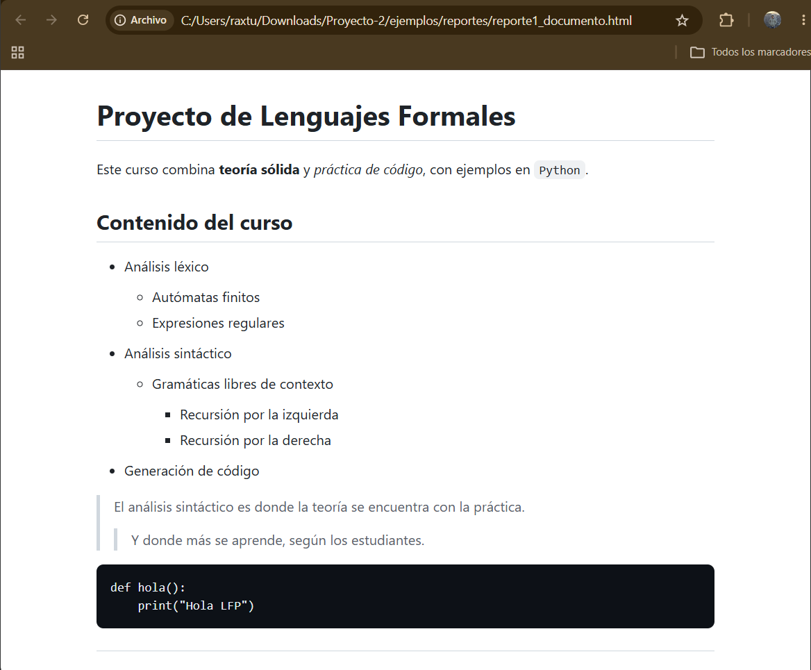

### 6.2 Reporte 2 — Estadísticas

| Sección | Qué muestra |
|---|---|
| Tarjetas | Palabras totales, párrafos, encabezados, listas, ítems de lista, citas, líneas de cita y bloques de código |
| Encabezados por nivel | Barras de H1 a H6 con su cantidad |
| Profundidad máxima de anidamiento | Niveles máximos alcanzados por las listas y por las citas |
| Elementos en línea | Cantidad de negritas, cursivas, códigos en línea y reglas horizontales |

Con `ejemplo_valido.md` los valores son: 67 palabras, 2 párrafos, 2 encabezados (1 de nivel H1 y 1 de H2), 8 ítems de lista, 2 líneas de cita, 1 bloque de código, listas de 3 niveles, citas de 2 niveles y 1 elemento de cada tipo en línea.

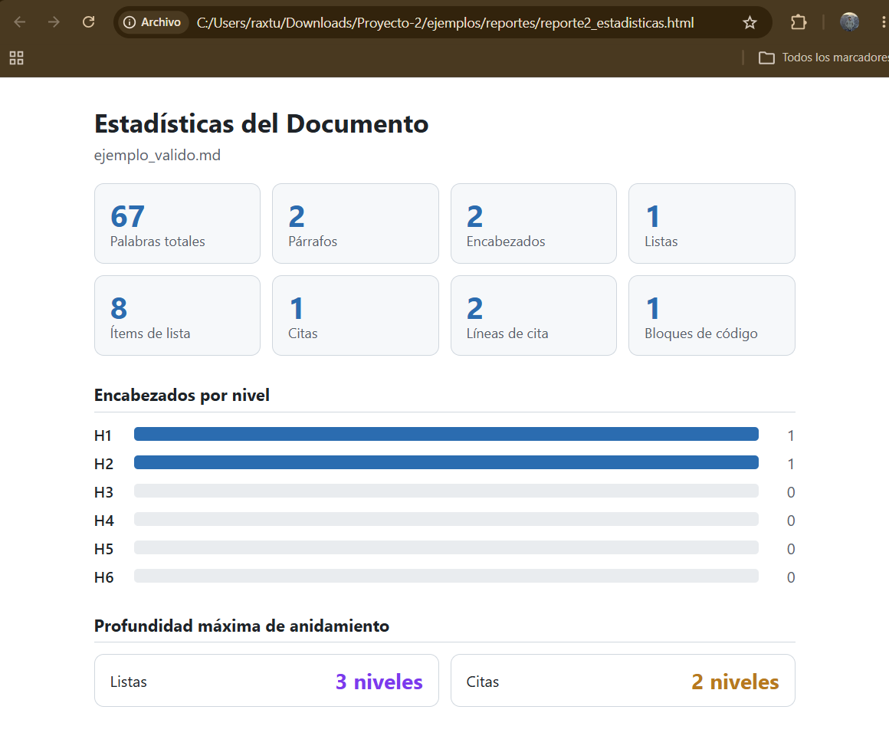

### 6.3 Reporte 3 — Tabla de contenido

Lista todos los encabezados, **más sangrados cuanto mayor es su nivel** (un H2 aparece bajo su H1). Cada entrada es un **enlace**: al hacer clic se abre el Reporte 1 posicionado en esa sección. Si el documento no tiene encabezados, el reporte lo indica explícitamente.

> Para que los enlaces funcionen, `reporte1_documento.html` y `reporte3_indice.html` deben permanecer **en la misma carpeta**.

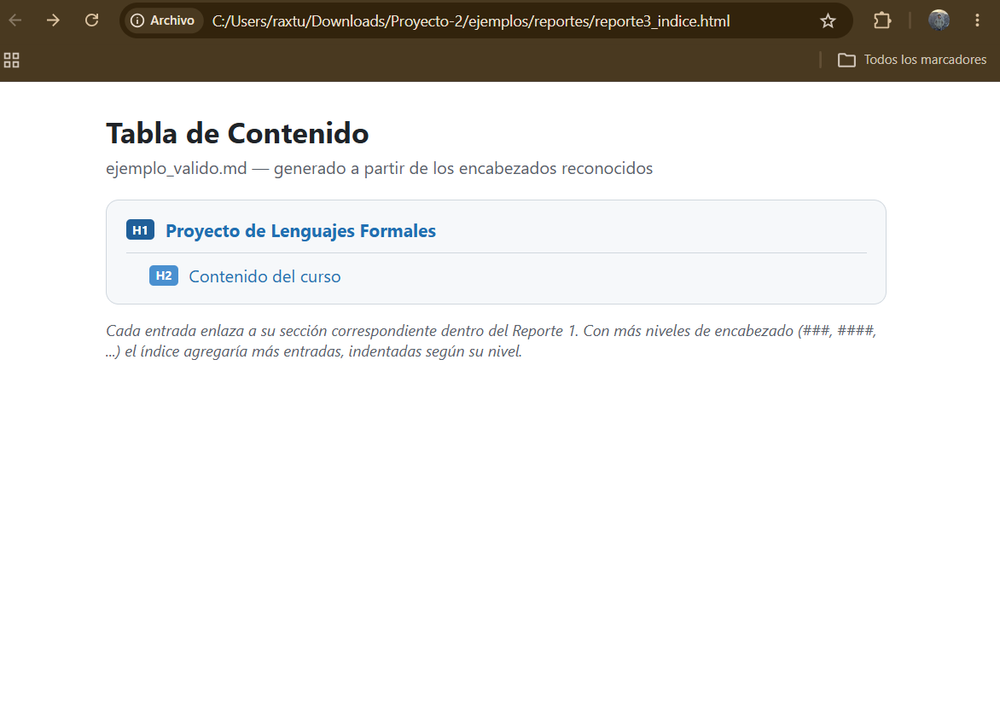

---

## 7. Otras funciones

### 7.1 Exportar el árbol (.dot)

1. Analice un documento.
2. Pulse **Exportar árbol (.dot)**, elija dónde guardar `arbol.dot` y confirme.
3. Si tiene **Graphviz** instalado (comando `dot`), la aplicación genera también `arbol.png` junto al `.dot`.

Sin Graphviz puede convertir el código manualmente en <https://dreampuf.github.io/GraphvizOnline> (pegue el contenido de `arbol.dot`) o con:

```bash
dot -Tpng arbol.dot -o arbol.png
```

> ### 📸 ESPACIO PARA CAPTURA U-13 — Exportar árbol
> **Qué capturar:** el diálogo «Guardar» de **Exportar árbol (.dot)** o el mensaje «Exportación completada» con las rutas generadas.
> **Archivo sugerido:** `docs/img/U-13_exportar_arbol.png`

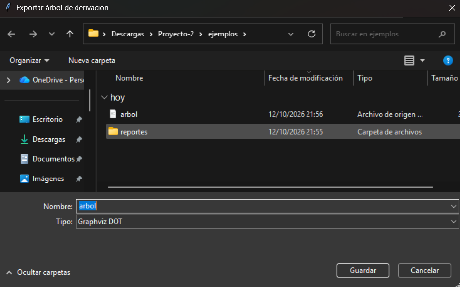

### 7.2 Exportar las tablas (HTML)

**Exportar tablas (HTML)** guarda en un único archivo la **tabla de tokens** y la **tabla de errores** del último análisis, para adjuntarlas a un informe.

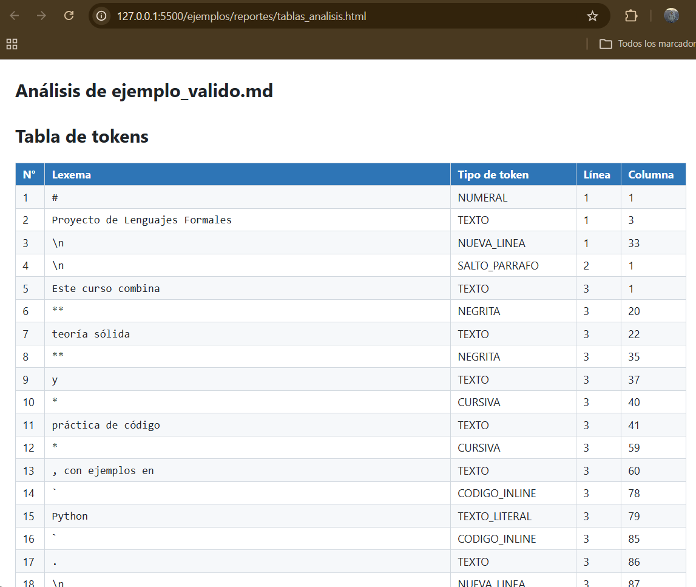
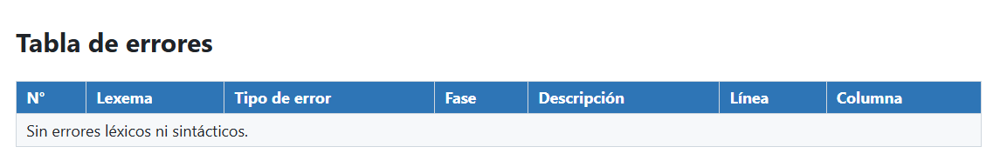

### 7.3 Guardar y limpiar

- **Guardar** guarda el contenido del editor en un archivo `.md`.
- **Limpiar** borra el editor y los resultados (pide confirmación si el editor tiene texto).

### 7.4 Modo consola (sin interfaz gráfica)

```bash
python src/main.py examples/ejemplo_valido.md --consola --salida reportes
```

Imprime la cantidad de tokens y, si hay errores, la lista de errores; si no los hay, genera los reportes y `arbol.dot` en la carpeta indicada.

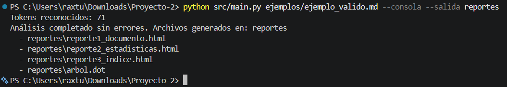

---

## 8. Sintaxis Markdown soportada

| Elemento | Cómo escribirlo | Ejemplo |
|---|---|---|
| **Encabezado** | De 1 a 6 `#` + **un espacio** + texto | `## Título` |
| **Párrafo** | Texto; separe los párrafos con una línea en blanco | `Hola mundo` |
| **Negrita** | Texto entre `**` | `**importante**` |
| **Cursiva** | Texto entre `*` | `*énfasis*` |
| **Negrita y cursiva** | Combinadas o anidadas | `***ambas***` · `**fuerte *suave* fin**` |
| **Código en línea** | Texto entre `` ` `` (no se interpreta lo de adentro) | `` `variable` `` |
| **Lista** | `-`, `*` o `+` + espacio al inicio de la línea | `- Elemento` |
| **Sublista** | 2 espacios más de sangría por nivel; se admiten 3 o más niveles | `  - Subelemento` |
| **Cita** | `>` + espacio; `>>` o `> >` para anidar | `>> Cita anidada` |
| **Bloque de código** | Línea con ```` ``` ```` (y opcionalmente el lenguaje), el código y otra línea ```` ``` ```` | ```` ```python ```` |
| **Regla horizontal** | Tres o más `-` solos en la línea | `---` |

**Reglas a tener en cuenta**

- `#sinespacio` **no** es un encabezado: se trata como texto.
- `-`, `*` o `+` solo son viñeta **al inicio de la línea y seguidos de un espacio**; en otro lugar, `*` abre una cursiva.
- Dentro de un bloque de código **nada se interpreta** (ni `#`, ni `**`, ni `-`).
- Una línea en blanco termina una lista y separa los bloques.
- Cada nivel de sublista equivale a 2 espacios más que su lista contenedora; saltar de golpe más de un nivel es un error.
- La negrita y la cursiva pueden continuar en la línea siguiente **solo si es el mismo párrafo**. El código en línea debe cerrarse en la misma línea.

**No soportado** (el analizador lo tratará como texto): listas ordenadas (`1.`), enlaces, imágenes, tablas, texto tachado y listas de tareas.

---

## 9. Solución de problemas

| Problema | Causa probable | Solución |
|---|---|---|
| `ModuleNotFoundError: No module named 'tkinter'` | Python sin Tkinter (común en Linux) | Linux: `sudo apt install python3-tk`. Windows/macOS: reinstale Python marcando la opción *tcl/tk* |
| `python` no se reconoce como comando | Python no está en el PATH | Use `py src/main.py` (Windows) o `python3 src/main.py` (Linux/macOS) |
| Los botones de reporte están deshabilitados | El documento tiene errores o no se ha analizado | Corrija los errores de la pestaña **Errores** y vuelva a pulsar **Analizar** |
| El Reporte 3 no abre las secciones | Los reportes no están en la misma carpeta | Mantenga `reporte1_documento.html` y `reporte3_indice.html` juntos |
| No se genera `arbol.png` | Graphviz no está instalado | Instálelo (<https://graphviz.org/download/>) o use el servicio en línea indicado en §7.1 |
| «Error al abrir» un archivo | Codificación no UTF-8 | Guarde el archivo como UTF-8 |
| Un `*` suelto produce `CURSIVA_SIN_CERRAR` | `*` fuera de una viñeta abre una cursiva | Cierre la cursiva o reescriba el texto (por ejemplo, `2 x 3` en lugar de `2 * 3`) |

---

*Fin del Manual de Usuario.*
